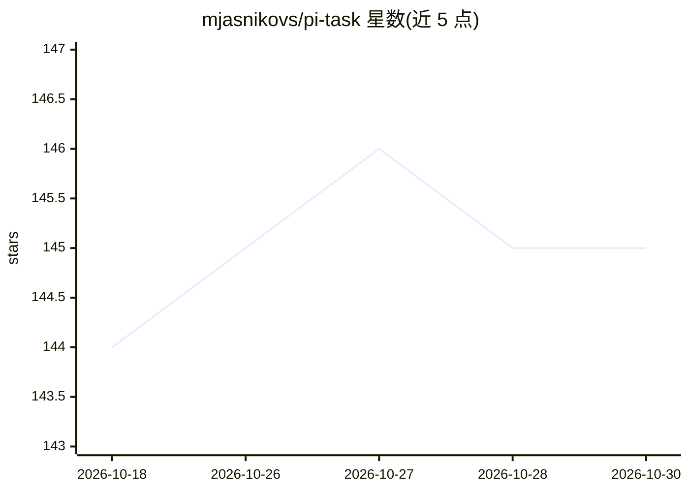

# mjasnikovs/pi-task

⭐ 145 · TypeScript · AGPL-3.0 · 推送 2026-10-24 · [GitHub](https://github.com/mjasnikovs/pi-task) · 个人维护

**面向本地模型的确定性规格编排 pi 扩展：固定流水线产出实现规格**

pi 编码代理的扩展（要求 pi ≥ 0.87），将用户请求驱动经过 refine→research→grill→compose→critique 五阶段固定流水线，产出实现规格交回主会话执行。研究阶段并行派发子代理（项目文件/API/领域上下文/工具）并核验工具声明；内置循环检测与失败分类以应对本地较小模型。阶段边界持久化为 Markdown 文件，任务可崩溃恢复、可取消续跑；附 /task-auto 多任务编排、每任务一提交、手机远程控制页等。通过 pi install npm 命令安装。

## 筛选速览

| 维度 | 判定 | 备注 |
|---|---|---|
| AI 角色 | `ai-ecosystem` | LLM/agent 周边工具 |
| 许可风险 | `viral` | AGPL-3.0 |
| 部署形态 | `library` | 以包/库形式分发 |
| 模型依赖 | — | README 未给出锁定关系 |
| 硬件要求 | — | 无带数字的原话,不猜 |
| 安装摩擦 | `low` | 无编译、无系统依赖或容器化 |
| 成熟度 | — | 结构信号不足 |

## 能力要点

- 五阶段固定流水线（refine/research/grill/compose/critique），阶段顺序为固定代码
- 并行研究子代理并核验工具声明，主会话只接收提炼结果
- 任务状态持久化为 Markdown，崩溃/重启/取消后可 /task-resume 恢复
- /task-auto 将功能分解为有序任务清单顺序执行，默认每任务一次 git 提交

## 适用场景

- 让本地小模型按可验证步骤生成代码实现规格
- 把大型设计文档拆分为有序任务清单逐个执行
- 在手机上远程回答澄清问题并监控任务进度

## 场景标签

`编码 Agent` · 领域:编码与开发

## 证据(README 行号)

> L5: **Deterministic spec-orchestration for local models — with bundled web, docs, fetch, and worker sub-agent tools.**
> L15: Local models drift. Ask one to plan a non-trivial change and it skips context, hallucinates APIs, and forgets what 
> L33: > Requires `pi` (the Earendil coding agent) ≥ 0.87.

## 星数曲线

2026-10-18 144 → 2026-10-30 145（+1）

---
*卡片 v1 · prompt 1.4 · 生成 2026-10-22 · 置信度 high · 依据 README sha `776c304f1ff4` · [字段定义](../../DATASET.md)*
