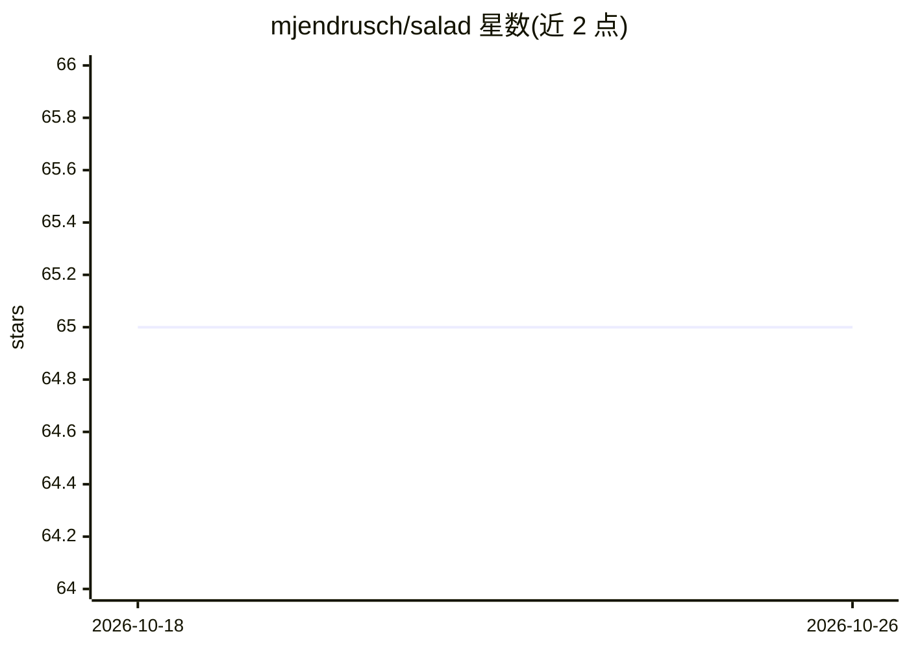

# mjendrusch/salad

⭐ 65 · Python · Apache-2.0 · 推送 2026-09-30 · [GitHub](https://github.com/mjendrusch/salad) · [官网](https://github.com/mjendrusch/salad) · 组织维护

**稀疏全原子去噪扩散模型家族，用于蛋白质结构生成**

salad 是基于去噪扩散模型的蛋白质结构生成模型家族与配套代码库，支持无条件生成（约 1,000 氨基酸以内）、对称/重复蛋白、motif scaffolding、形状条件生成与多状态设计；仓库同时提供训练与评测代码、PDB 数据加载与稀疏几何模块。通过 git clone + pip install -e . 安装，预训练参数从 Zenodo 下载，需 jax 0.5.0（0.5.1-0.5.3 有兼容问题）；主要在 Linux 上开发测试，ARM 设备暂不支持 GPU 安装。序列设计与基准评测需另行安装 ProteinMPNN 与 novobench，另有 flexcraft 封装流水线与 Colab 快速体验。

## 筛选速览

| 维度 | 判定 | 备注 |
|---|---|---|
| AI 角色 | `ai-native` | 本体是模型或模型工具 |
| 许可风险 | `permissive` | Apache-2.0 |
| 部署形态 | `library` | 以包/库形式分发 |
| 模型依赖 | — | README 未给出锁定关系 |
| 硬件要求 | — | 无带数字的原话,不猜 |
| 安装摩擦 | `low` | 无编译、无系统依赖或容器化 |
| 成熟度 | — | 结构信号不足 |

## 能力要点

- 去噪扩散模型生成蛋白质结构，支持约 1,000 氨基酸
- 支持 motif scaffolding、对称/重复蛋白、形状条件与多状态设计
- 提供训练与评测代码及预训练参数（Zenodo 下载）
- 配套 ProteinMPNN 序列设计与 novobench 基准评测脚本

## 适用场景

- 从头设计指定长度的蛋白质结构
- 为给定 motif 做支架设计或设计对称/重复蛋白
- 生成结构后用 ProteinMPNN 设计序列并用 ESMflow 评测

## 场景标签

 · 领域:计算生物学/蛋白质设计

## 证据(README 行号)

> L29: salad (**s**parse **al**l-**a**tom **d**enoising) is the name of a family of machine learning models for controlled
> L38: Like previous models, salad models can generate protein structures for a variety of protein design tasks:
> L52: This repository contains the code for training and evaluating the

## 星数曲线

2026-10-18 65 → 2026-10-26 65（+0）

---
*卡片 v1 · prompt 1.4 · 生成 2026-10-24 · 置信度 mid · 依据 README sha `a1ffd04f55e5` · [字段定义](../../DATASET.md)*
