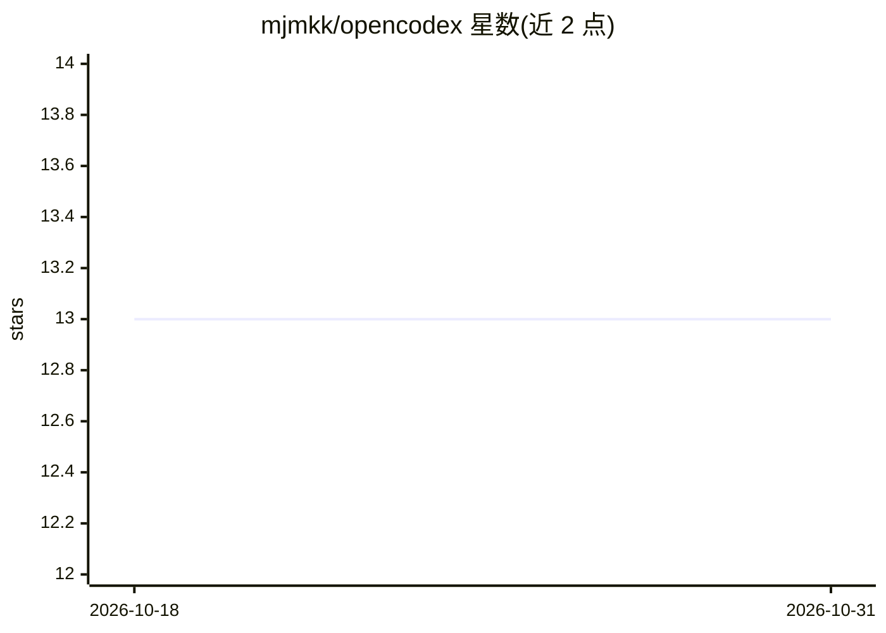

# mjmkk/opencodex

⭐ 13 · Swift · Apache-2.0 · 推送 2026-10-23 · [GitHub](https://github.com/mjmkk/opencodex) · [官网](https://github.com/mjmkk/opencodex/blob/main/docs/deployment.md) · 个人维护 · 中文 README

**在 iPhone 上远程监督 Mac 本地 Claude/Codex 编程助手的 iOS 客户端**

由 SwiftUI/TCA iOS 应用与本地 Mac 上的 Node.js Worker 后端组成：iPhone 连接 Worker 后可与 Claude/Codex 进行多轮对话，查看流式输出（SSE）、审批高危命令、浏览编辑项目文件并操作 WebSocket 远程终端。运行依赖本机 codex CLI（app-server）与账号权限，仓库不含其实现；需 macOS、Xcode 16+、Node.js ≥22 与 iOS 17+，Worker 可经 Docker 或 npm 启动，iOS 端需 Xcode 编译。推荐 Tailscale 做远程组网。

## 筛选速览

| 维度 | 判定 | 备注 |
|---|---|---|
| AI 角色 | `ai-ecosystem` | LLM/agent 周边工具 |
| 许可风险 | `permissive` | Apache-2.0 |
| 部署形态 | `library` | 以包/库形式分发 |
| 模型依赖 | — | README 未给出锁定关系 |
| 硬件要求 | — | 无带数字的原话,不猜 |
| 安装摩擦 | `medium` | 含编译或系统依赖之一 |
| 成熟度 | — | 结构信号不足 |

## 能力要点

- 多线程对话、SSE 流式输出与命令审批（批准/拒绝/修改）
- WebSocket 半屏终端（自动重连、PTY resize）与文件浏览/编辑
- 本地优先：Worker 与 codex app-server 运行在自己的 Mac 上
- Worker 提供 Docker 与 Node.js 两种启动方式

## 适用场景

- 离开桌面后在 iPhone 上监督和审批 AI agent 的编码任务
- 手机上查看 agent 执行日志并浏览/编辑项目文件
- 通过终端透传直接执行确定性命令

## 场景标签

`编码 Agent` · 领域:编码与开发

## 证据(README 行号)

> L26: OpenCodex is an **iOS client + local Node.js Worker backend** development platform.
> L27: Connect your iPhone to a Worker service running on your Mac to engage in multi-turn conversations with Claude / Cod
> L86: - **codex CLI** — Worker calls `codex app-server` internally (API Key must be configured)

## 星数曲线

2026-10-18 13 → 2026-10-31 13（+0）

---
*卡片 v1 · prompt 1.4 · 生成 2026-10-31 · 置信度 high · 依据 README sha `c5a6376ae5bf` · [字段定义](../../DATASET.md)*
