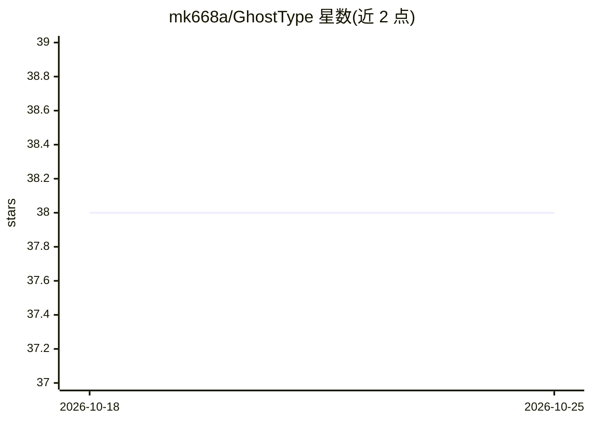

# mk668a/GhostType

⭐ 38 · Swift · MIT · 推送 2026-08-11 · [GitHub](https://github.com/mk668a/GhostType) · 个人维护 · 中文 README

**macOS 全局文本框 Tab 补全工具，完全本地运行**

面向 Mac 用户的输入法级自动补全应用：输入暂停后在光标处显示灰色补全文本，按 Tab 接受，覆盖 Safari、Notes、Mail、Slack 等任意 macOS 文本框。内置 llama-server（llama.cpp）或对接用户已有的 Ollama/LM Studio/vLLM 等外部服务器，均走 OpenAI 兼容端点；支持 fill-in-the-middle（/infill）与 GBNF 约束生成。无云端推理、无遥测。要求 macOS 14+、Apple Silicon，需授予输入监控与辅助功能权限；应用未经公证，首次启动需手动放行。

## 筛选速览

| 维度 | 判定 | 备注 |
|---|---|---|
| AI 角色 | `ai-native` | 本体是模型或模型工具 |
| 许可风险 | `permissive` | MIT |
| 部署形态 | `desktop` | 安装包/桌面程序 |
| 模型依赖 | local-ok | 支持本地模型 |
| 硬件要求 | — | 无带数字的原话,不猜 |
| 安装摩擦 | `medium` | 含编译或系统依赖之一 |
| 成熟度 | — | 结构信号不足 |

## 能力要点

- 内置 llama-server 或复用外部服务器（Ollama/LM Studio/llama.cpp/vLLM/LocalAI）
- fill-in-the-middle 补全与 GBNF 约束生成
- 5 个内置 Qwen 基座/GGUF 模型可选，模型仅存本机
- 无云端推理、无遥测、无账号

## 适用场景

- 在邮件、聊天、浏览器文本框中获得整句补全
- 复用本机已加载的 LLM 做全局输入补全
- 不联网、不上传输入内容的本地输入辅助

## 场景标签

`代码生成` `AI 助手` · 领域:编码与开发

## 证据(README 行号)

> L7: **Tab-to-complete autocomplete for every text field on your Mac, running entirely on your own machine.**
> L14:  Typing pauses, grey ghost text appears at the cursor, Tab accepts it
> L36: That is a real completion from a bundled model. It works the same way in Safari, Notes, Mail, Slack, and any other 

## 星数曲线

2026-10-18 38 → 2026-10-25 38（+0）

---
*卡片 v1 · prompt 1.4 · 生成 2026-10-25 · 置信度 high · 依据 README sha `eb4252b3c851` · [字段定义](../../DATASET.md)*
