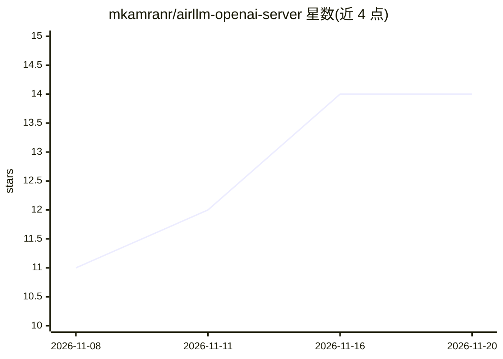

# mkamranr/airllm-openai-server

⭐ 14 · Python · Apache-2.0 · 推送 2026-08-08 · [GitHub](https://github.com/mkamranr/airllm-openai-server) · 个人维护

**为 AirLLM 提供 OpenAI 兼容 API 层，让大模型跑在小显存设备上**

在 AirLLM 之上封装 OpenAI 兼容 HTTP 服务：AirLLM 通过逐层流式加载权重（每个 token 从磁盘读取各层权重）使 70B 模型在 4GB 显存运行，本项目补充请求校验、chat 模板、流式输出、用量统计、准入控制与打包。生成是单飞行模式，吞吐为秒级每 token，磁盘是主要约束。支持 Linux/Windows/macOS Apple silicon/CPU/Docker，Intel macOS 无法运行 AirLLM。面向希望用现有 OpenAI SDK/LangChain/聊天 UI 直接接入的开发者。

## 筛选速览

| 维度 | 判定 | 备注 |
|---|---|---|
| AI 角色 | `ai-ecosystem` | LLM/agent 周边工具 |
| 许可风险 | `permissive` | Apache-2.0 |
| 部署形态 | `self-host` | docker 或自建部署 |
| 模型依赖 | — | README 未给出锁定关系 |
| 硬件要求 | `cpu-ok` | |
| 安装摩擦 | `low` | 无编译、无系统依赖或容器化 |
| 成熟度 | — | 结构信号不足 |

## 能力要点

- OpenAI 兼容端点（chat/completions、completions、models、health）
- AirLLM 逐层流式加载：70B 模型 4GB 显存、405B 8GB，无需量化
- 单飞行生成、队列限制与 503 负载削减
- 多平台运行矩阵：NVIDIA/CPU/Apple silicon (torch/MPS/mlx)/Docker/Compose

## 适用场景

- 显存不足的机器上用现有 OpenAI SDK 调用大模型
- 把已有 LangChain 应用或聊天 UI 指向本地大模型端点
- CPU 或 Apple silicon 设备上运行大模型推理服务

## 场景标签

`推理引擎` · 领域:训练与推理

## 证据(README 行号)

> L3: > **An OpenAI-compatible API wrapper around AirLLM by
> L9: AirLLM runs large language models on small GPUs by streaming
> L11: card, 405B on 8GB, without quantization or distillation. This server wraps it in the API your

## 星数曲线

2026-11-08 11 → 2026-11-20 14（+3）

---
*卡片 v1 · prompt 1.4 · 生成 2026-11-18 · 置信度 high · 依据 README sha `a2f4a5bb30e7` · [字段定义](../../DATASET.md)*
