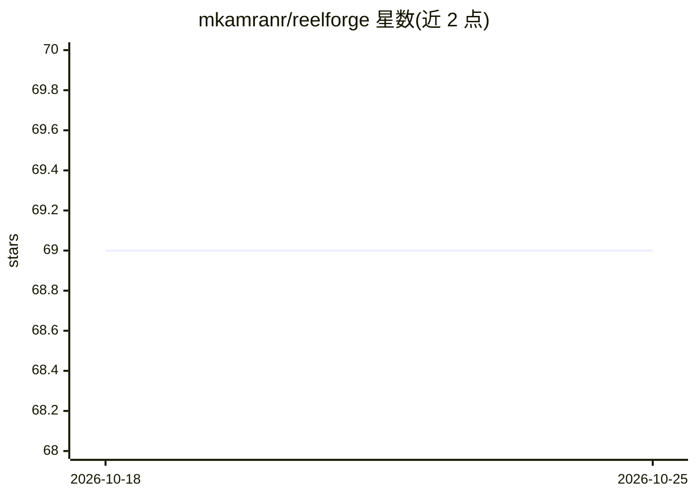

# mkamranr/reelforge

⭐ 69 · Python · 推送 2026-09-29 · [GitHub](https://github.com/mkamranr/reelforge) · 个人维护

**把 GitHub 仓库或 HF 模型自动做成竖版短视频的自托管流水线**

输入一个仓库或模型 URL，十阶段流水线自动完成事实抓取、脚本撰写、旁白合成或上传、逐词对齐、分镜生成、渲染与按平台规范校验，输出成品 mp4、封面图、各平台文案与校验报告；每阶段产物均为可编辑文件，改上游会失效下游。视觉可接 ComfyUI 或 Pexels，旁白可用 Kokoro/Fish-Speech/上传人声，LLM 可走本地 Ollama 全离线。仅支持 1080×1920 一种画幅，不做发布，一次只跑一个任务。

## 筛选速览

| 维度 | 判定 | 备注 |
|---|---|---|
| AI 角色 | `ai-native` | 本体是模型或模型工具 |
| 许可风险 | `none` | — |
| 部署形态 | `self-host` | docker 或自建部署 |
| 模型依赖 | local-ok | 支持本地模型 |
| 硬件要求 | — | 无带数字的原话,不猜 |
| 安装摩擦 | `low` | 无编译、无系统依赖或容器化 |
| 成熟度 | — | 结构信号不足 |

## 能力要点

- 十阶段流水线，每阶段产物可审查编辑，重跑上游自动失效下游
- 18 项断言按 Instagram/YouTube 实际规范校验编码
- 生成式分镜经八级检查（解析/白名单/逐词校验/试渲染等）后才进入渲染
- 支持全本地运行：Ollama 本地 LLM + Kokoro 本地 TTS，无需 API key

## 适用场景

- 把开源项目或 HF 模型做成 Reels/Shorts 推广短视频
- 自托管批量生产带旁白和封面的竖版短视频
- 无 GPU 场景用 Pexels 图库替代生成式画面

## 场景标签

`视频生成` `AI 写作` `语音合成` `图像生成` · 领域:内容生成

## 证据(README 行号)

> L13: Turn a GitHub repository or a Hugging Face model into a finished vertical reel —
> L16: Paste a URL. The pipeline fetches the facts, writes the script, generates or
> L53: |`content`|Script, narration phrases, fact sheet, cover spec, platform copy|`content.json`, `<slug>.txt`|

## 星数曲线

2026-10-18 69 → 2026-10-25 69（+0）

---
*卡片 v1 · prompt 1.4 · 生成 2026-10-24 · 置信度 mid · 依据 README sha `1530295de411` · [字段定义](../../DATASET.md)*
