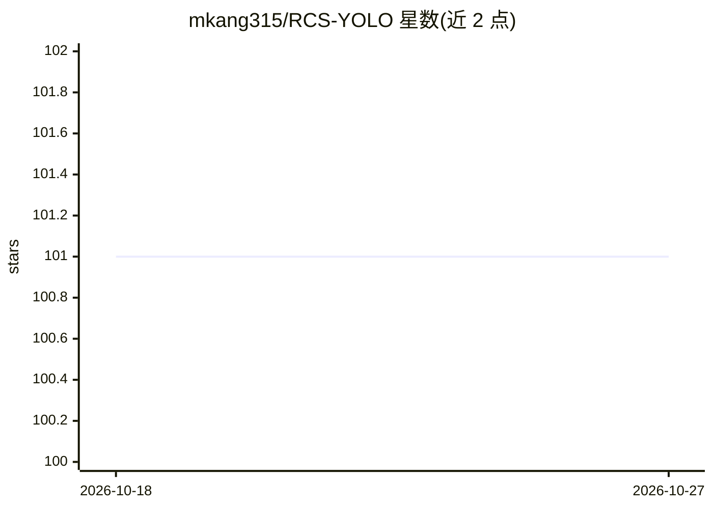

# mkang315/RCS-YOLO

⭐ 101 · Python · GPL-3.0 · 推送 2026-09-22 · [GitHub](https://github.com/mkang315/RCS-YOLO) · 个人维护

**MICCAI'23 论文官方实现：脑肿瘤检测目标检测模型 RCS-YOLO**

MICCAI 2023 论文《RCS-YOLO: A Fast and High-Accuracy Object Detector for Brain Tumor Detection》的第一作者官方源码。模型基于 RepVGG/RepConv ShuffleNet 结构，提出 RCS-OSA 模块，提供 2 头与 3 头两种网络配置（rcs-yolo.yaml / rcs3-yolo.yaml）。支持单 GPU 与多 GPU 分布式训练、测试脚本与预训练权重，在 Br35H 脑肿瘤检测数据集（500 训练/201 测试）上评估。依赖 Python>=3.8、Torch<=1.7.1、CUDA<=11.1，GPL-3.0 许可，部分工具代码基于 YOLOv7、RepVGG、ShuffleNet、VoVNetV2 仓库。

## 筛选速览

| 维度 | 判定 | 备注 |
|---|---|---|
| AI 角色 | `ai-native` | 本体是模型或模型工具 |
| 许可风险 | `viral` | GPL-3.0 |
| 部署形态 | `library` | 以包/库形式分发 |
| 模型依赖 | — | README 未给出锁定关系 |
| 硬件要求 | — | 无带数字的原话,不猜 |
| 安装摩擦 | `medium` | 含编译或系统依赖之一 |
| 成熟度 | — | 结构信号不足 |

## 能力要点

- 提出 RCS-OSA 模块（models/rcsosa.py）
- 提供 2 头/3 头两种模型配置文件
- 支持单 GPU 与多 GPU 分布式训练命令
- 附 Br35H 数据集预训练权重 best.pt 与消融实验脚本

## 适用场景

- 复现 MICCAI'23 论文的脑肿瘤检测实验
- 在 Br35H 数据集上训练或测试检测模型
- 基于 RCS-OSA 模块开展医学影像检测研究

## 场景标签

`目标检测` · 领域:感知与多模态

## 证据(README 行号)

> L8: This is the source code for the paper titled "RCS-YOLO: A Fast and High-Accuracy Object Detector for Brain Tumor Det
> L11: The RepVGG/RepConv ShuffleNet You Only Look Once (RCS-YOLO) model configuration (i.e., network construction) file i

## 星数曲线

2026-10-18 101 → 2026-10-27 101（+0）

---
*卡片 v1 · prompt 1.4 · 生成 2026-10-23 · 置信度 high · 依据 README sha `171d081361db` · [字段定义](../../DATASET.md)*
