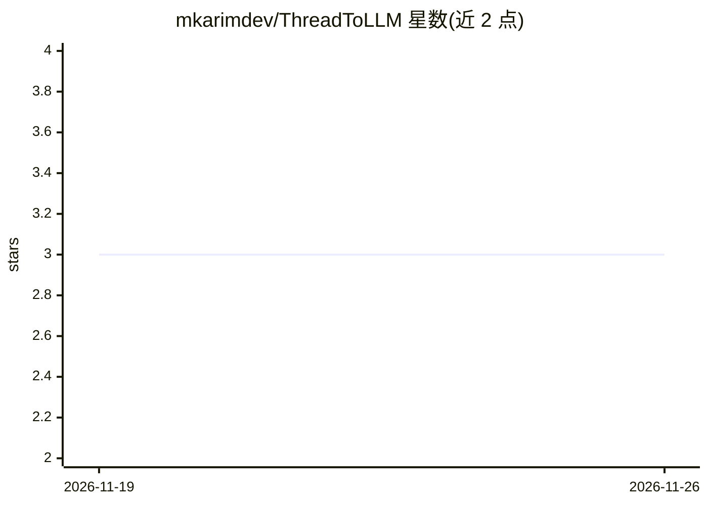

# mkarimdev/ThreadToLLM

⭐ 3 · TypeScript · MIT · 推送 2026-11-19 · [GitHub](https://github.com/mkarimdev/ThreadToLLM) · 个人维护

**面向 LLM 用户的 Reddit 帖子转 Markdown 浏览器扩展**

Chrome 浏览器扩展（Manifest V3），将 Reddit 讨论帖提取为带 YAML frontmatter 的 token 紧凑 Markdown 并复制到剪贴板，供用户粘贴到 Claude、ChatGPT、Gemini 或本地模型中使用。解析、噪声过滤与 Markdown 序列化全部在浏览器本地执行，无后端服务器与遥测，仅需 clipboardWrite 权限。安装方式为从 GitHub Releases 下载 ZIP 后以 Load unpacked 方式载入 Chrome；从源码构建需 Node.js 22+ 与 npm。

## 筛选速览

| 维度 | 判定 | 备注 |
|---|---|---|
| AI 角色 | `ai-native` | 本体是模型或模型工具 |
| 许可风险 | `permissive` | MIT |
| 部署形态 | `desktop` | 安装包/桌面程序 |
| 模型依赖 | — | README 未给出锁定关系 |
| 硬件要求 | — | 无带数字的原话,不猜 |
| 安装摩擦 | `low` | 无编译、无系统依赖或容器化 |
| 成熟度 | — | 结构信号不足 |

## 能力要点

- 将 Reddit 讨论线程重建为保留递归层级、OP 标注与结构化元数据的 Markdown
- 通过剪贴板一键复制（页面按钮或 Alt+Shift+C 快捷键），自动过滤机器人/版主噪声
- 纯客户端 DOM 提取，无遥测、无外部服务器，仅需 clipboardWrite 权限
- 基于 Manifest V3，支持从 Releases 安装或从源码构建

## 适用场景

- 把 Reddit 讨论帖粘贴给 ChatGPT/Claude 分析时减少无效 token 占用
- 保留评论递归层级与 OP 归属以便模型理解对话结构
- 在 Reddit 页面用快捷键快速提取当前帖子内容

## 场景标签

`文档解析` · 领域:知识与检索

## 证据(README 行号)

> L8: Extract Reddit discussion threads into token-dense, clean Markdown optimized for LLM prompting (Claude, ChatGPT, Gem
> L15: > - **100% Client-Side DOM Extraction**: Discussion parsing, noise filtering, and Markdown serialization execute en

## 星数曲线

2026-11-19 3 → 2026-11-26 3（+0）

---
*卡片 v1 · prompt 1.4 · 生成 2026-11-21 · 置信度 high · 依据 README sha `d55b88c6bc5b` · [字段定义](../../DATASET.md)*
