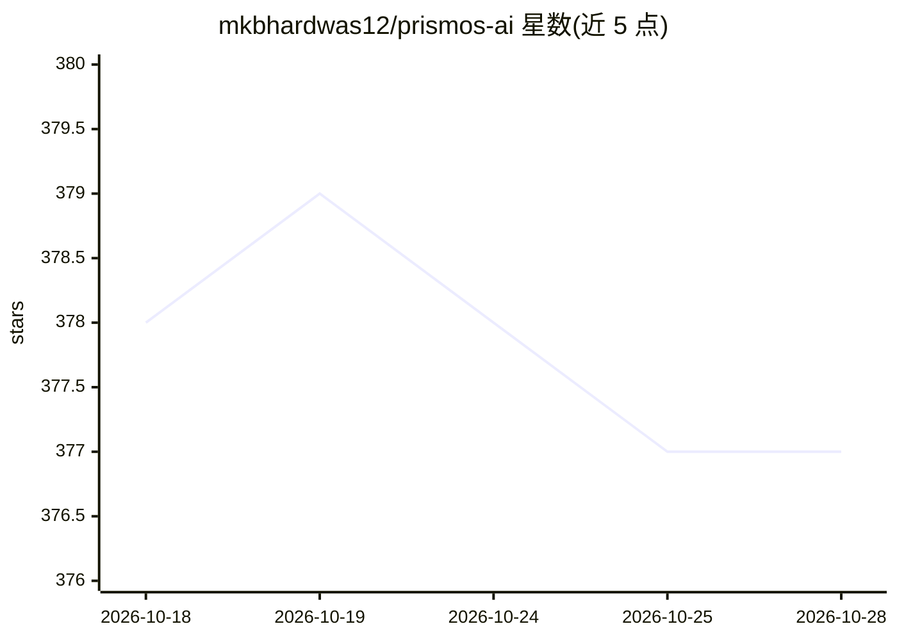

# mkbhardwas12/prismos-ai

⭐ 377 · Rust · MIT · 推送 2026-10-06 · [GitHub](https://github.com/mkbhardwas12/prismos-ai) · [官网](https://github.com/mkbhardwas12/prismos-ai) · 个人维护

**本地优先的桌面 AI：离线聊天读文件、生成 3D 场景、查日志加固配置**

基于 Tauri 2 + React 18 + Rust 的本地桌面 AI 应用，面向不愿将文档上传云端的使用者：接入本机 Ollama 模型进行流式对话，读取 PDF/DOCX/PPTX/XLSX 并以 TF-IDF 检索，答案与概念存入本地 SQLite 知识图谱供后续会话使用。另支持一行提示生成实时 three.js 3D 场景、日志事件调查（映射 MITRE ATT&CK）、配置加固、生成报告/幻灯片/HTML 应用、whisper.cpp 侧车转录录音。推理仅走 127.0.0.1 回环 Ollama，可选联网功能默认关闭；安装包未签名，首次运行需约 2.5GB 模型权重与约 4GB 空闲内存。

## 筛选速览

| 维度 | 判定 | 备注 |
|---|---|---|
| AI 角色 | `ai-native` | 本体是模型或模型工具 |
| 许可风险 | `permissive` | MIT |
| 部署形态 | `desktop` | 安装包/桌面程序 |
| 模型依赖 | local-ok | 支持本地模型 |
| 硬件要求 | — | 无带数字的原话,不猜 |
| 安装摩擦 | `low` | 无编译、无系统依赖或容器化 |
| 成熟度 | — | 结构信号不足 |

## 能力要点

- 答案与概念持久化到本地 SQLite 知识图谱，后续会话可检索
- 推理仅经回环 Ollama 守护进程，本地模型装好后可离线工作
- 一行提示生成内联 three.js 的实时 3D 场景（单 HTML 文件、CSP 禁网）
- 多 Agent 角色对回答投票，可选 HMAC-SHA256 签名的答案回执与矛盾警报

## 适用场景

- 在不允许把文档粘贴进云端 AI 的合规环境下本地问答
- 投喂日志做事件调查、映射 MITRE ATT&CK 并给出加固建议
- 离线转录会议录音并索引为知识图谱

## 场景标签

`文档问答` `知识图谱` `网络安全` `语音识别` · 领域:知识与检索

## 证据(README 行号)

> L9: Client files, contracts, internal specs: drop them in and ask. A local Ollama model answers, and what it learns goes
> L35: |**Talks to any local model**|Streaming chat against any Ollama model; curated registry of 18 models with hardware-
> L37: |**Builds a living 3D scene from one line**|`/scene a voxel lighthouse on a rocky island in a storm at night` and a

## 星数曲线

2026-10-18 378 → 2026-10-28 377（-1）

---
*卡片 v1 · prompt 1.4 · 生成 2026-10-21 · 置信度 mid · 依据 README sha `37ad9351139e` · [字段定义](../../DATASET.md)*
