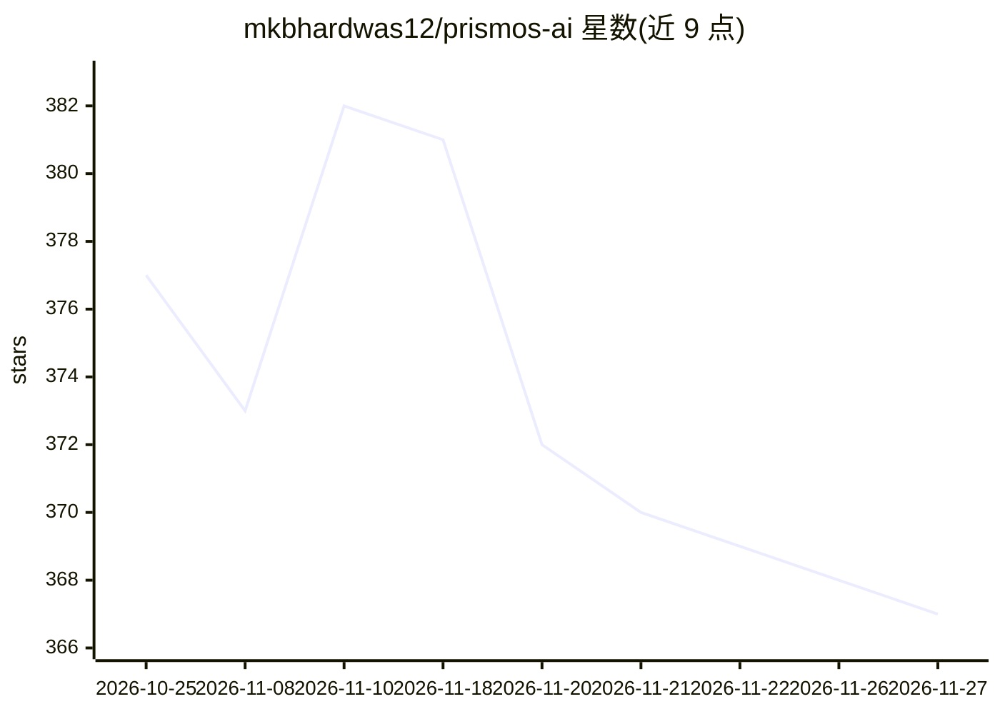

# mkbhardwas12/prismos-ai

⭐ 367 · Rust · MIT · 推送 2026-11-02 · [GitHub](https://github.com/mkbhardwas12/prismos-ai) · [官网](https://github.com/mkbhardwas12/prismos-ai) · 个人维护

**本地优先桌面 AI：离线对话文档、生成 3D 场景与日志取证**

基于 Tauri 2 + React 18 + Rust 的桌面应用，通过仅回环地址的 Ollama 守护进程运行本地模型，覆盖三大主线：读取 PDF/DOCX/PPTX/XLSX 并以 TF-IDF 检索、把问答沉淀到本地 SQLite 知识图谱供后续会话复用；从一行提示生成带 three.js 的浏览器 3D 场景与自包含 HTML 应用；对日志输出映射 MITRE ATT&CK 的调查报告、对 sshd/nginx/K8s 等配置给出逐条修复建议。附五个 agent 角色投票机制、HMAC 签名的回答回执与可选的 whisper.cpp 转录，无账号、无遥测。

## 筛选速览

| 维度 | 判定 | 备注 |
|---|---|---|
| AI 角色 | `ai-native` | 本体是模型或模型工具 |
| 许可风险 | `permissive` | MIT |
| 部署形态 | `desktop` | 安装包/桌面程序 |
| 模型依赖 | local-ok | 支持本地模型 |
| 硬件要求 | — | 无带数字的原话,不猜 |
| 安装摩擦 | `low` | 无编译、无系统依赖或容器化 |
| 成熟度 | — | 结构信号不足 |

## 能力要点

- 仅回环 Ollama 推理，文档不离机，断网可用
- 本地 SQLite 知识图谱跨会话记忆，支持 3D/2D 图谱浏览
- 日志调查映射 MITRE ATT&CK，配置文件逐条给修复
- 五个 agent 角色投票 + 设备绑定密钥签名的回答回执

## 适用场景

- 对不能粘贴到云端服务的合同与内部文档提问
- 从一行描述生成可离线打开的 3D 场景或 HTML 小应用
- 分析服务器日志并加固 sshd/nginx/K8s 配置
- 把会议录音在本地转写并索引进知识图谱

## 场景标签

`文档问答` `知识图谱` `网络安全` `语音识别` · 领域:知识与检索

## 证据(README 行号)

> L7: Mac, Windows or Linux · runs on your own laptop · free and open source
> L9: Client files, contracts, internal specs: drop them in and ask. A local Ollama model answers, and what it learns goes
> L148: embeddings—use the fixed `http://127.0.0.1:11434` daemon. The desktop and CLI

## 星数曲线

2026-10-25 377 → 2026-11-27 367（-10）

---
*卡片 v1 · prompt 1.4 · 生成 2026-11-25 · 置信度 mid · 依据 README sha `1aafe11fd13e` · [字段定义](../../DATASET.md)*
