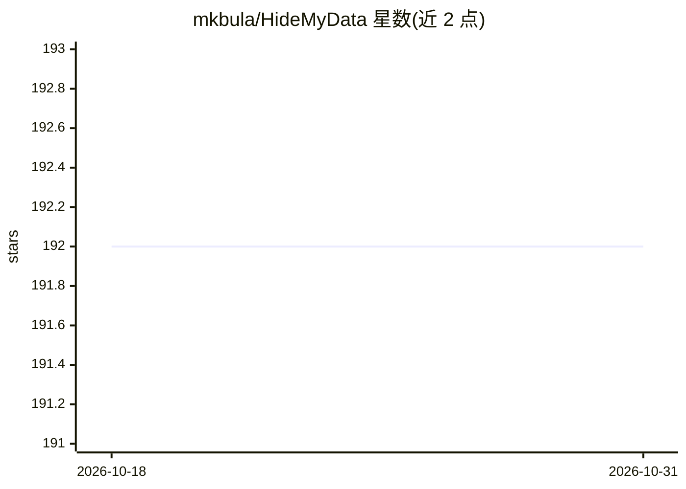

# mkbula/HideMyData

⭐ 192 · Swift · GPL-3.0 · 推送 2026-05-05 · [GitHub](https://github.com/mkbula/HideMyData) · 个人维护

**macOS 本地 PII 检测与涂黑工具（PDF/图片）**

原生 macOS 应用，对 PDF 与图片做个人身份信息（PII）检测和涂改：Apple Vision 负责 OCR（含扫描件与嵌入字体不可选的 PDF），OpenAI privacy-filter 模型经 MLX 8-bit 量化在设备上运行，识别姓名、邮箱、电话、地址、日期、证件号等，另配手工维护的正则规则覆盖 IBAN、SSN、JWT、API key 等。保存时页面被栅格化重建，原文不残留。要求 macOS 26+ 与 Apple Silicon，首次启动需从 Hugging Face 下载约 1.5 GB 模型。以 GPL-3.0 发布，提供 dmg 安装包或 Xcode 源码构建。

## 筛选速览

| 维度 | 判定 | 备注 |
|---|---|---|
| AI 角色 | `ai-native` | 本体是模型或模型工具 |
| 许可风险 | `viral` | GPL-3.0 |
| 部署形态 | `desktop` | 安装包/桌面程序 |
| 模型依赖 | — | README 未给出锁定关系 |
| 硬件要求 | — | 无带数字的原话,不猜 |
| 安装摩擦 | `low` | 无编译、无系统依赖或容器化 |
| 成熟度 | — | 结构信号不足 |

## 能力要点

- 全本地运行，OCR 用 Apple Vision，检测模型 MLX 8-bit 在设备上运行
- PDF 与图片共用同一检测/涂改流水线
- 正则规则覆盖 IBAN/SSN/JWT/API key/加密钱包地址等
- 保存时栅格化重建页面，原文字形不残留

## 适用场景

- 在本地涂改 PDF 或图片中的个人敏感信息后分享
- 处理扫描版或文字不可选的 PDF 中的隐私内容
- 发布文档前手动增删涂改区域再导出

## 场景标签

 · 领域:隐私/文档处理

## 证据(README 行号)

> L19: - **Fully local** — model runs on-device, nothing ever leaves your machine
> L22: - **AI detection** — OpenAI `privacy-filter` (MLX 8-bit) catches names, emails, phones, addresses, dates, IDs in co

## 星数曲线

2026-10-18 192 → 2026-10-31 192（+0）

---
*卡片 v1 · prompt 1.4 · 生成 2026-10-22 · 置信度 high · 依据 README sha `237d9dfe6aa4` · [字段定义](../../DATASET.md)*
