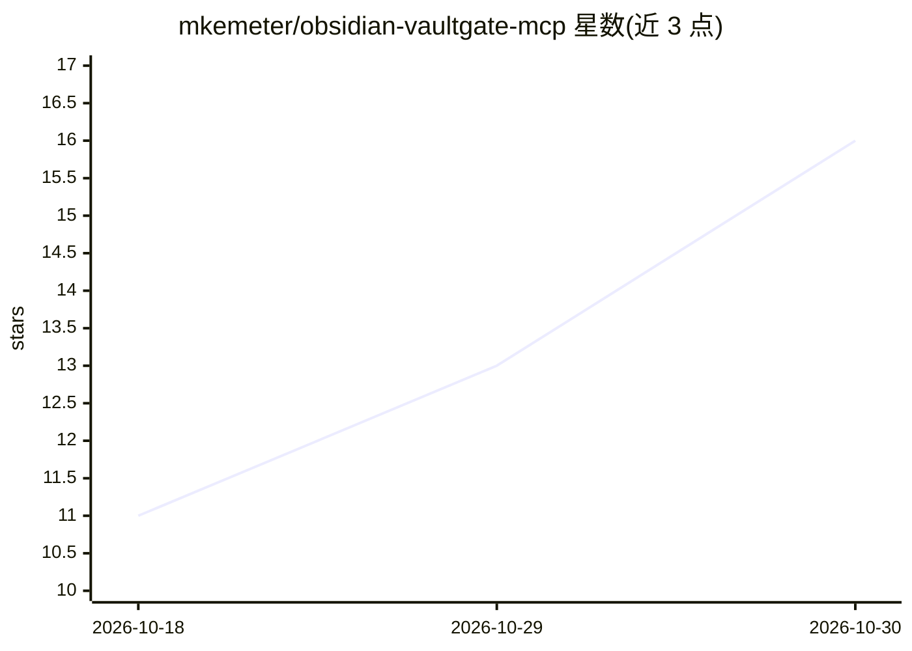

# mkemeter/obsidian-vaultgate-mcp

⭐ 16 · TypeScript · GPL-3.0 · 推送 2026-10-29 · [GitHub](https://github.com/mkemeter/obsidian-vaultgate-mcp) · 个人维护

**让任意 MCP AI 客户端本地读写 Obsidian 笔记库的 MCP 服务器**

本地运行的 Model Context Protocol 服务器，将 MCP 兼容的 AI 客户端（Claude、Cursor、Zed、Joule Work Desktop 等）与运行中的 Obsidian 实例连接。设计上不直接读写 vault 文件，所有操作委托给 Obsidian 内置 CLI API；服务器仅绑定 127.0.0.1。提供读笔记、全文与离线语义检索（@xenova/transformers 本地嵌入）、任务管理、模板应用、两步预览确认写入等工具；VAULTGATE.md 约定文件自动注入会话。两种发行：headless npm 包（macOS/Linux/Windows）与 macOS Apple Silicon 托盘应用（DMG）。要求 Obsidian 1.8.9+，npm 包需 Node.js 18+。

## 筛选速览

| 维度 | 判定 | 备注 |
|---|---|---|
| AI 角色 | `ai-ecosystem` | LLM/agent 周边工具 |
| 许可风险 | `viral` | GPL-3.0 |
| 部署形态 | `desktop` | 安装包/桌面程序 |
| 模型依赖 | — | README 未给出锁定关系 |
| 硬件要求 | — | 无带数字的原话,不猜 |
| 安装摩擦 | `low` | 无编译、无系统依赖或容器化 |
| 成熟度 | — | 结构信号不足 |

## 能力要点

- 所有读写经运行中的 Obsidian 实例中转，不直接操作 vault 文件
- 基于 @xenova/transformers 的全离线语义检索
- 写入采用预览+确认两步机制，无静默修改
- 仅绑定 127.0.0.1，零外部网络调用

## 适用场景

- 在 Claude/Cursor 等 AI 客户端中用自然语言查询和编辑自己的笔记库
- 让 AI 按自己的库结构约定（VAULTGATE.md）管理笔记与任务
- 在本地离线环境下对笔记做语义搜索

## 场景标签

`知识库管理` `语义搜索` · 领域:知识与检索

## 证据(README 行号)

> L14: VaultGate is a local Model Context Protocol server that bridges any MCP-compatible AI client with your Obsidian vau
> L30: Joule Work Desktop, Claude, Cursor, Windsurf, Zed, and anything else that speaks MCP — via HTTP or stdio.

## 星数曲线

2026-10-18 11 → 2026-10-30 16（+5）

---
*卡片 v1 · prompt 1.4 · 生成 2026-10-30 · 置信度 high · 依据 README sha `533529dbfb44` · [字段定义](../../DATASET.md)*
