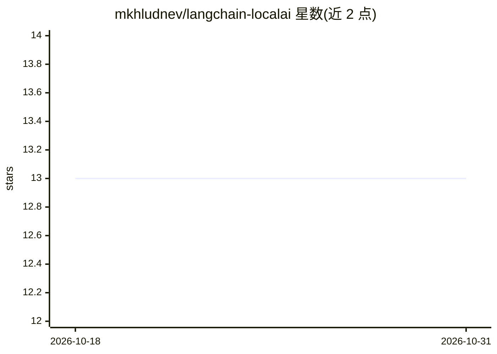

# mkhludnev/langchain-localai

⭐ 13 · Python · MIT · 推送 2025-12-13 · [GitHub](https://github.com/mkhludnev/langchain-localai) · [官网](https://python.langchain.com/docs/integrations/text_embedding/localai/) · 个人维护

**LocalAI 嵌入与重排器的 LangChain 集成包**

为 LangChain 提供 LocalAI Embeddings 和 LocalAI Reranker（cross-encoder）的集成包，从 Langchain community 包衍生而来。基于 OpenAI SDK v1，提供更快的批量嵌入请求、异步支持和重排功能。面向在本地或私有网络部署 LocalAI、需要在 LangChain 中使用嵌入与重排能力的团队和用户。要求 Python >=3.10、langchain-core ^1.0.0。通过 pip 安装。

## 筛选速览

| 维度 | 判定 | 备注 |
|---|---|---|
| AI 角色 | `ai-ecosystem` | LLM/agent 周边工具 |
| 许可风险 | `permissive` | MIT |
| 部署形态 | `library` | 以包/库形式分发 |
| 模型依赖 | — | README 未给出锁定关系 |
| 硬件要求 | — | 无带数字的原话,不猜 |
| 安装摩擦 | `low` | 无编译、无系统依赖或容器化 |
| 成熟度 | — | 结构信号不足 |

## 能力要点

- LocalAI Embeddings 集成，支持批量嵌入请求
- LocalAI Reranker（cross-encoder）集成
- 依赖 OpenAI SDK v1，支持异步调用

## 适用场景

- 在 LangChain 应用中调用本地 LocalAI 服务生成嵌入
- 为私有网络部署的检索系统添加重排能力
- 替换 community 包以获得批量嵌入与异步支持

## 场景标签

`语义搜索` · 领域:知识与检索

## 证据(README 行号)

> L3: This project provides Langchain integration package for LocalAI Embeddings and for LocalAI Reranker..
> L28: Teams deploying LocalAI locally or within private networks and users who require reliable, performant embeddings an

## 星数曲线

2026-10-18 13 → 2026-10-31 13（+0）

---
*卡片 v1 · prompt 1.4 · 生成 2026-10-31 · 置信度 high · 依据 README sha `bae99a8d186f` · [字段定义](../../DATASET.md)*
