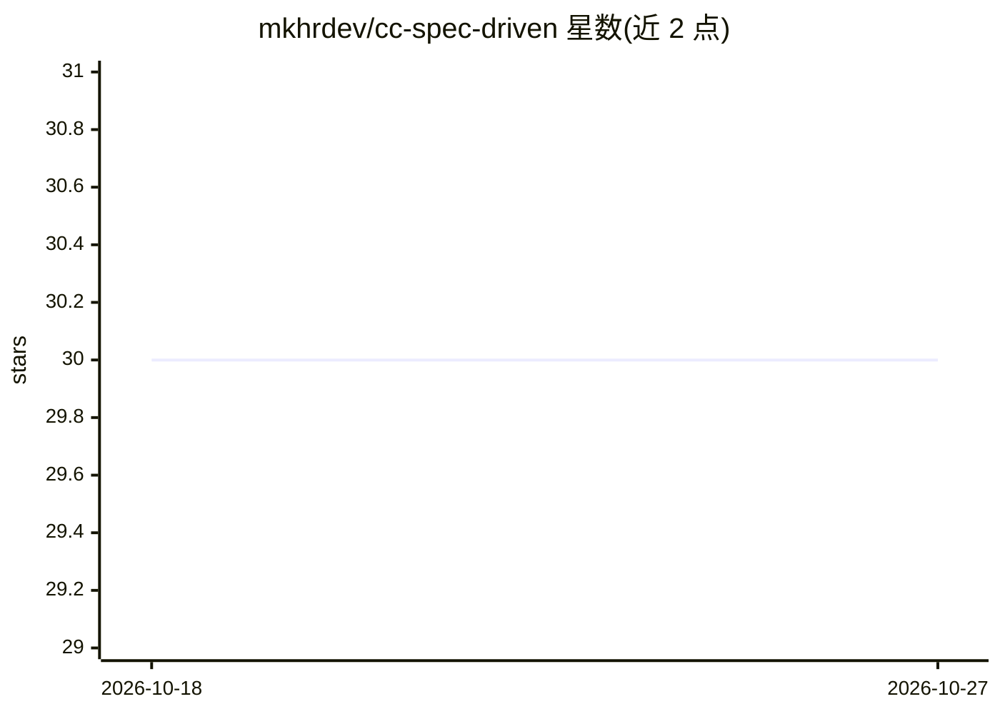

# mkhrdev/cc-spec-driven

⭐ 30 · 推送 2026-01-26 · [GitHub](https://github.com/mkhrdev/cc-spec-driven) · 个人维护 · 中文 README

**Claude Code 插件：以规格文档驱动开发，管理需求与变更追踪**

面向 Claude Code 用户的规格驱动开发插件：通过 /dd- 系列命令管理需求文档、变更请求（CR）与发布候选（RC）状态流转，维护 feature 依赖图（deps/affects），生成开发/测试规格供下游工具生成代码并完成 E2E 测试。通过 Hook 机制强制工程化约束（索引同步、依赖重建、回滚警告），采用 Level 0-3 分层上下文加载以优化 token 用量，支持 Git 分支并行工作与测试用例 blessed 复用。

## 筛选速览

| 维度 | 判定 | 备注 |
|---|---|---|
| AI 角色 | `ai-ecosystem` | LLM/agent 周边工具 |
| 许可风险 | `permissive` | — |
| 部署形态 | `None` |  |
| 模型依赖 | locked-api |  |
| 硬件要求 | — | 无带数字的原话,不猜 |
| 安装摩擦 | `low` | 无编译、无系统依赖或容器化 |
| 成熟度 | — | 结构信号不足 |

## 能力要点

- CR/RC 状态机（draft→confirmed→done/dropped）管理需求变更
- Hook 机制强制索引同步、依赖重建与回滚清理等工程约束
- 双向依赖跟踪（deps/affects）与全局依赖图 _deps.yaml 影响分析
- Level 0-3 分层上下文加载，按需加载降低 token 消耗

## 适用场景

- 在 Claude Code 中以规格文档为唯一事实来源管理需求变更
- 让下游工具基于生成的规格产出代码与 E2E 测试用例
- 多分支并行开发时独立管理各自的变更与合并冲突

## 场景标签

`编码 Agent` · 领域:编码与开发

## 证据(README 行号)

> L15: cc-spec-driven, a Claude Code plugin for managing requirement documents, tracking changes, and outputting specs — e
> L27: After installation, type `/dd-` in Claude Code to see all available commands.
> L74: Traditional AI documentation tools rely on prompt constraints, which are easily overlooked or simplified. This fram

## 星数曲线

2026-10-18 30 → 2026-10-27 30（+0）

---
*卡片 v1 · prompt 1.4 · 生成 2026-10-26 · 置信度 high · 依据 README sha `e2eb81f4e5d0` · [字段定义](../../DATASET.md)*
