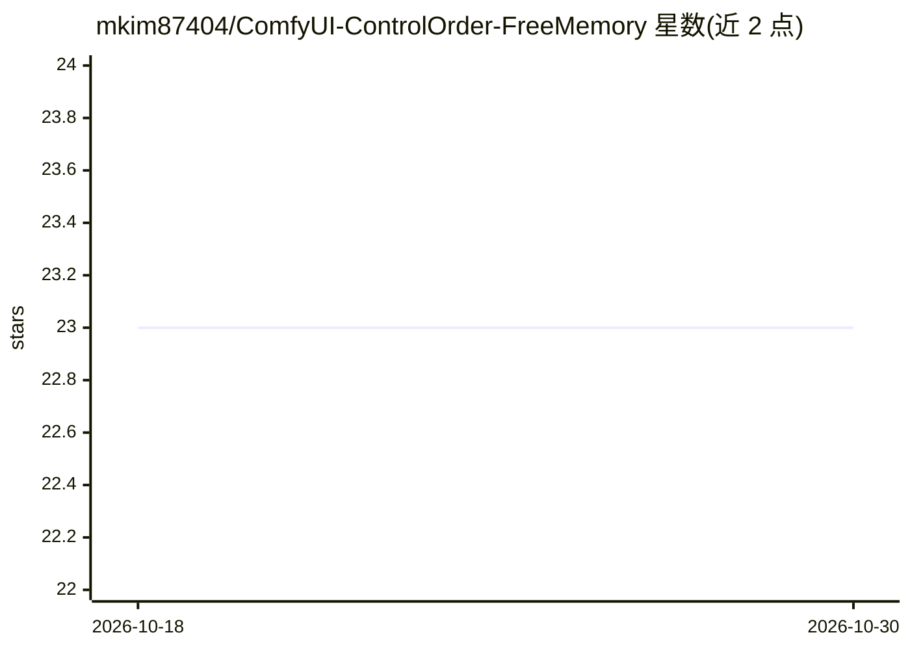

# mkim87404/ComfyUI-ControlOrder-FreeMemory

⭐ 23 · Python · MIT · 推送 2026-04-15 · [GitHub](https://github.com/mkim87404/ComfyUI-ControlOrder-FreeMemory) · 个人维护

**ComfyUI 自定义节点：控制节点执行顺序并按需释放显存/内存**

面向 ComfyUI 用户的自定义节点，通过 AnyType 输入/输出槽对任意类型与数量的数据进行线性路由，强制工作流按单一顺序执行；可在工作流任意位置卸载模型、释放 VRAM/RAM，同时保留经节点传递的数据。配套 Filename Selector 辅助节点用于向加载类节点传入文件名。附带 Wan 2.2 与 LTX 2.3 示例工作流。实现依赖 ComfyUI 当前 model_management 模块与扩展钩子，未来 ComfyUI 更新可能导致部分功能失效；显存充足时开启内存释放可能产生反效果。

## 筛选速览

| 维度 | 判定 | 备注 |
|---|---|---|
| AI 角色 | `ai-ecosystem` | LLM/agent 周边工具 |
| 许可风险 | `permissive` | MIT |
| 部署形态 | `None` |  |
| 模型依赖 | — | README 未给出锁定关系 |
| 硬件要求 | — | 无带数字的原话,不猜 |
| 安装摩擦 | `low` | 无编译、无系统依赖或容器化 |
| 成熟度 | — | 结构信号不足 |

## 能力要点

- AnyType 槽位自适应扩展，支持任意类型/数量的数据线性传递
- 在任意节点位置卸载模型并释放 VRAM/RAM，保留传递数据
- 无外部依赖，设备/平台无关
- 附 Filename Selector 辅助节点与示例工作流

## 适用场景

- 多模型竞争显存的工作流中分段加载/卸载模型
- 强制工作流按单一顺序执行，理顺连线
- 高分辨率生成前释放显存以避免 OOM

## 场景标签

 · 领域:AI 工作流工具/ComfyUI 生态

## 证据(README 行号)

> L10: `🔷 Control Order & Free Memory` is a dependency-free ComfyUI custom node for controlling the execution order of nod
> L14: The memory clean up + linear passthrough of data facilitated by this node can help to **speed up certain workflows*

## 星数曲线

2026-10-18 23 → 2026-10-30 23（+0）

---
*卡片 v1 · prompt 1.4 · 生成 2026-10-27 · 置信度 high · 依据 README sha `c3311ab346ee` · [字段定义](../../DATASET.md)*
