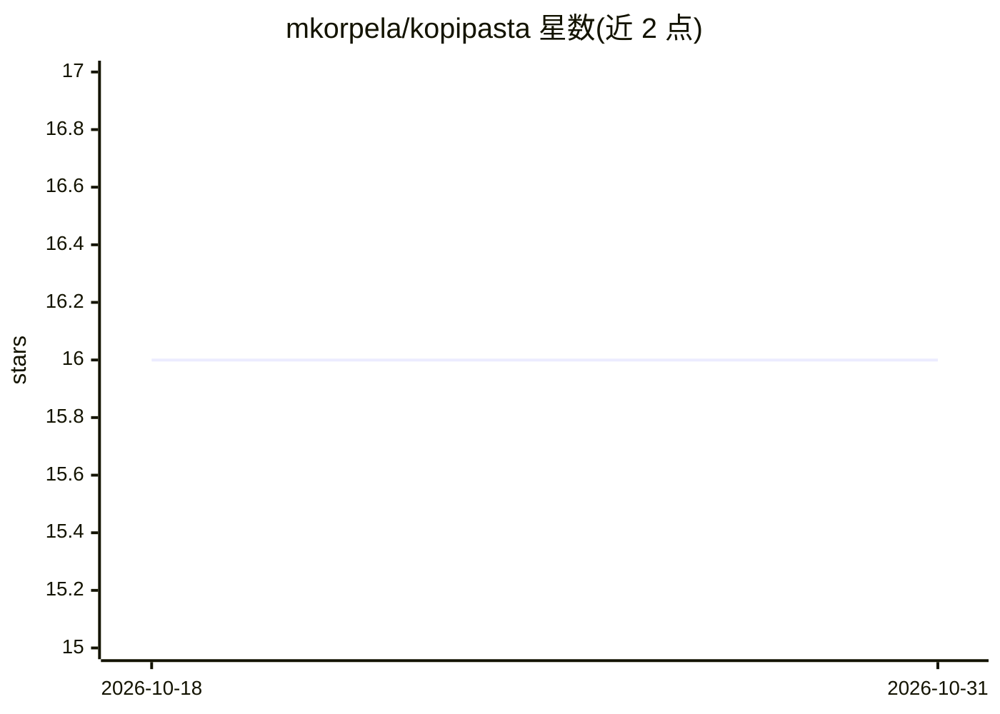

# mkorpela/kopipasta

⭐ 16 · Python · MIT · 推送 2026-08-17 · [GitHub](https://github.com/mkorpela/kopipasta) · 个人维护

**终端 LLM 编码工具：显式控制上下文、生成并应用补丁**

面向终端用户与 agent 的 CLI 工具，围绕一个引擎提供两种形态：交互式 TUI（选文件、组装 prompt、粘贴回复、应用补丁）和 headless 命令 kopipasta ask，供 agent 通过 shell 调用。核心机制是显式上下文控制：用 pin/ref/map/snippet 四态选择文件，超预算时按 full→AST骨架→路径 逐级降级，无隐藏 RAG 或向量检索。支持 triage、distill、coordinated patch 三种工作流，apply 阶段可执行 verify 命令并在失败时回滚。后端经配置指定，支持 gemini/anthropic/openai 及 OpenAI 兼容服务。每次 ask 以纯文件形式记录会话。

## 筛选速览

| 维度 | 判定 | 备注 |
|---|---|---|
| AI 角色 | `ai-ecosystem` | LLM/agent 周边工具 |
| 许可风险 | `permissive` | MIT |
| 部署形态 | `library` | 以包/库形式分发 |
| 模型依赖 | locked-api |  |
| 硬件要求 | — | 无带数字的原话,不猜 |
| 安装摩擦 | `low` | 无编译、无系统依赖或容器化 |
| 成熟度 | — | 结构信号不足 |

## 能力要点

- 四态文件选择（pin/ref/map/snippet）与超预算逐级降级，pin 文件不降级
- kopipasta ask 作为独立进程的上下文 oracle，返回假设、排序文件列表与指针，供 agent 调用
- patch 提议与应用分离，apply --verify 执行校验命令、--revert-on-fail 失败回滚
- 支持 gemini/anthropic/openai 及 OpenAI 兼容后端、exec: 与 claude-cli: 通道，会话以纯文件落盘

## 适用场景

- 在终端手动挑选文件组成 prompt，向 LLM 提问并应用补丁
- agent 调用 headless CLI 做全仓 triage，避免自身上下文被大量文件读取污染
- 跨多文件的大规模协调修改：pin 工作集、校验测试、失败自动回滚
- 审计每次请求实际发送了哪些内容（会话以纯文件记录）

## 场景标签

`编码 Agent` · 领域:编码与开发

## 证据(README 行号)

> L16: - **`kopipasta ask`** — the headless CLI. Selection comes from argv, the question goes
> L30: `kopipasta ask` is a **context oracle**: a separate process with its own large, disposable
> L233: OpenAI-compatible server), plus `exec:<command>` and `claude-cli:` which borrow whatever CLI

## 星数曲线

2026-10-18 16 → 2026-10-31 16（+0）

---
*卡片 v1 · prompt 1.4 · 生成 2026-10-30 · 置信度 mid · 依据 README sha `76e64e446790` · [字段定义](../../DATASET.md)*
