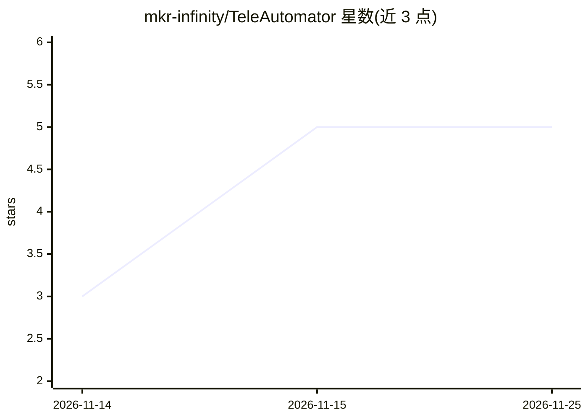

# mkr-infinity/TeleAutomator

⭐ 5 · Python · NOASSERTION · 推送 2026-11-17 · [GitHub](https://github.com/mkr-infinity/TeleAutomator) · [官网](https://github.com/mkr-infinity/TeleAutomator#readme) · 个人维护

**基于 LLM 的 Telegram 个人账号自动回复机器人**

基于 Telethon MTProto 的 Telegram userbot，为个人账号生成上下文感知的自动回复，接入 Google Gemini 与 OpenAI 等模型，支持自定义 base URL 与多模型 fallback。三种运行模式：draft 仅存 SQLite、approval 经 Control Bot 人工批准后发送、restricted_auto 自动回复白名单群聊。通过 Telegram Mini App 面板或手机命令远程管理上下文、语气、静默时段与配额；含草稿审批、多聊天护栏、语音回复与偏好导入导出。AI 不可用时回复保持静默，无离线兜底。

## 筛选速览

| 维度 | 判定 | 备注 |
|---|---|---|
| AI 角色 | `ai-native` | 本体是模型或模型工具 |
| 许可风险 | `none` | NOASSERTION |
| 部署形态 | `None` |  |
| 模型依赖 | — | README 未给出锁定关系 |
| 硬件要求 | — | 无带数字的原话,不猜 |
| 安装摩擦 | `low` | 无编译、无系统依赖或容器化 |
| 成熟度 | — | 结构信号不足 |

## 能力要点

- draft/approval/restricted_auto 三种运行模式与人工审批草稿机制
- 通过 Control Bot 命令与 Mini App 面板远程切换模型、语气、静默时段
- 按聊天的隔离上下文文件、置顶消息同步与语音画像生成
- 出站检查阻止 @标签、链接与已知参与者名，强制冷却间隔

## 适用场景

- 让个人 Telegram 账号在白名单群聊中自动维持对话回复
- 以审批模式生成回复草稿并人工确认后再发送
- 为不同群聊设置独立人设、语言与静默时段

## 场景标签

`聊天机器人` · 领域:对话与助手

## 证据(README 行号)

> L5:  The open, modern AI-powered Telegram userbot and personal automation assistant.
> L6:  Context-aware auto-replies with Google Gemini & OpenAI LLMs, Telethon MTProto user account client, and an Android M
> L108: |**`/provider <name>`**|Switch AI engine (`custom`, `gemini`, `openai`, `nvidia`, `local`)|`/provider custom`|

## 星数曲线

2026-11-14 3 → 2026-11-25 5（+2）

---
*卡片 v1 · prompt 1.4 · 生成 2026-11-21 · 置信度 high · 依据 README sha `42f3aa9dc339` · [字段定义](../../DATASET.md)*
