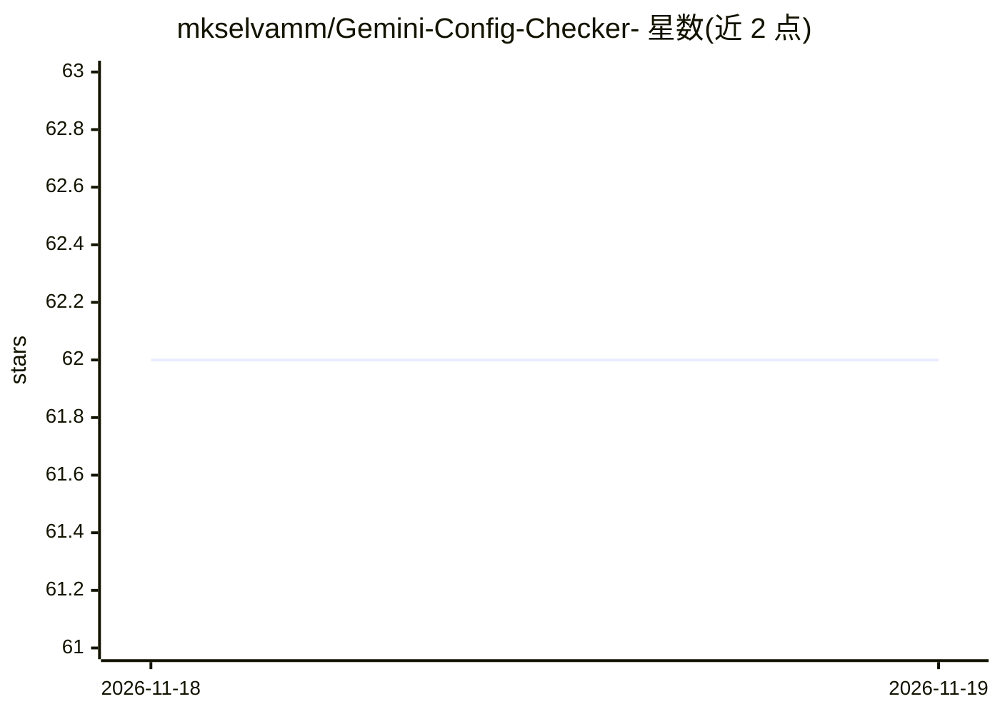

# mkselvamm/Gemini-Config-Checker-

⭐ 62 · Go · Apache-2.0 · 推送 2026-11-18 · [GitHub](https://github.com/mkselvamm/Gemini-Config-Checker-) · 个人维护

**扫描代理配置并验证能否登录访问 Google AI Studio 与 Gemini**

桌面/Web 工具，用真实登录浏览器逐个测试代理配置：Simple 模式批量检测自有配置（vless/vmess/trojan/ss 链接、订阅 URL、base64），Advanced 模式将免费配置链在可用基础配置之后寻找可用出口。内置 Xray 引擎与 Anti-DPI 分片转发器（Finalmask/指纹/ALPN/密码套件），支持导出链接、base64 与链式 Xray 配置。区域检查需 Chrome/Edge/Brave 并登录 Google；Android 仅支持连通性模式；Web UI 无鉴权，仅限本机使用。

## 筛选速览

| 维度 | 判定 | 备注 |
|---|---|---|
| AI 角色 | `ai-ecosystem` | LLM/agent 周边工具 |
| 许可风险 | `permissive` | Apache-2.0 |
| 部署形态 | `desktop` | 安装包/桌面程序 |
| 模型依赖 | — | README 未给出锁定关系 |
| 硬件要求 | — | 无带数字的原话,不猜 |
| 安装摩擦 | `medium` | 含编译或系统依赖之一 |
| 成熟度 | `idea` | |

## 能力要点

- 以登录浏览器读取 Google 区域判定（AI Studio 重定向/Gemini 国家提示），而非 HTTP 探测
- Simple/Advanced 双模式，支持基础配置+免费配置链式扫描与链式 Xray 配置导出
- 可编辑 Anti-DPI 分片参数（Finalmask、fingerprint、ALPN、cipher suites）
- Windows/macOS/Linux 桌面与 Web server 构建，Android 提供 APK（仅连通性模式）

## 适用场景

- 批量测试手里已有的代理配置哪些能进 AI Studio 和 Gemini
- Cloudflare 配置连通但出口被 Google 拦时，寻找其他可用出口
- 检查准备长期使用的单个配置是否可用

## 场景标签

 · 领域:网络工具/代理配置检测

## 证据(README 行号)

> L11: Find proxy configs that actually get you into **Google AI Studio and Gemini**, by testing each one the way a person
> L50: Google decides region availability **per signed-in account, after the page has loaded**. A plain HTTP request (even
> L155: |Check type|Region with signed-in browser|**Region**: opens AI Studio and Gemini and reads Google's verdict (accur

## 星数曲线

2026-11-18 62 → 2026-11-19 62（+0）

---
*卡片 v1 · prompt 1.4 · 生成 2026-11-19 · 置信度 high · 依据 README sha `7d4e3e000e83` · [字段定义](../../DATASET.md)*
