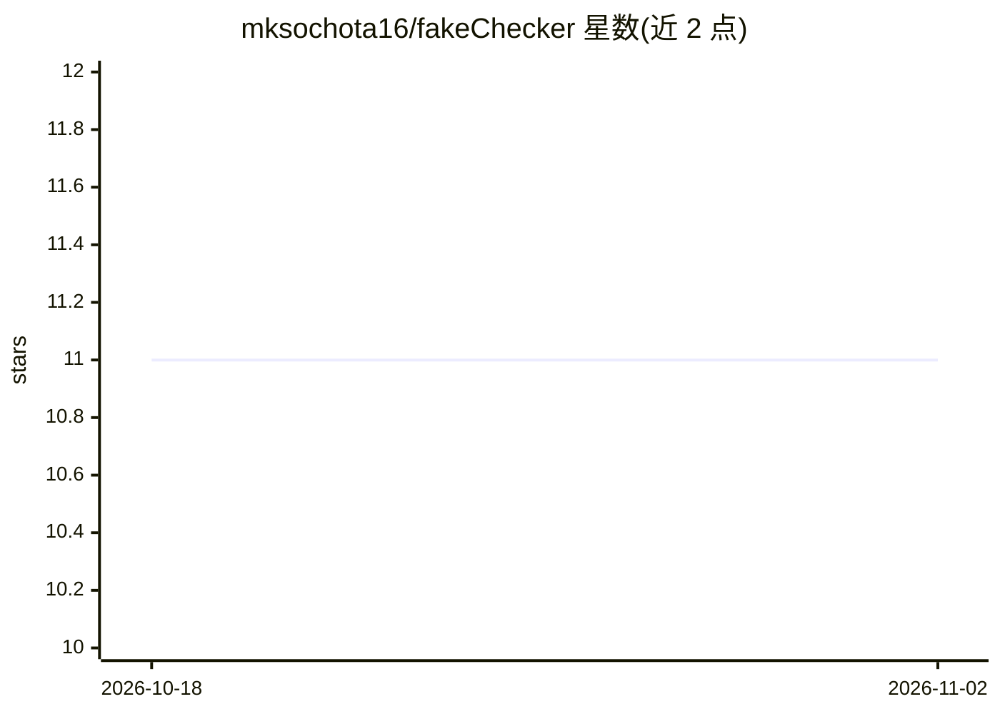

# mksochota16/fakeChecker

⭐ 11 · Python · 推送 2026-05-07 · [GitHub](https://github.com/mksochota16/fakeChecker) · 个人维护

**自托管 FastAPI 服务：检测 Google Maps 波兰语评论可信度**

华沙工业大学工程论文项目的一部分，以自托管 FastAPI 服务形式提供，用预训练模型分析评论文本特征，预测 Google Maps 评论可信或可疑。预训练模型针对波兰语数据调优，也可为其他语言训练新模型使用。运行需 Python 3.10+、requirements.txt 所列库、MongoDB（自托管或云端）、至少一个 Geocode API（Google Maps/positionstack/Geoapify）的密钥，以及下载 Gensim 的 word2vec_800_3_polish 词向量模型，通过 .env 文件配置密钥。

## 筛选速览

| 维度 | 判定 | 备注 |
|---|---|---|
| AI 角色 | `ai-native` | 本体是模型或模型工具 |
| 许可风险 | `none` | — |
| 部署形态 | `None` |  |
| 模型依赖 | — | README 未给出锁定关系 |
| 硬件要求 | — | 无带数字的原话,不猜 |
| 安装摩擦 | `low` | 无编译、无系统依赖或容器化 |
| 成熟度 | — | 结构信号不足 |

## 能力要点

- FastAPI 服务形式自托管部署
- 预训练模型针对波兰语评论数据调优
- 支持为其他语言自行训练模型
- 依赖 Word2Vec 词向量做文本特征分析

## 适用场景

- 运营方筛查 Google Maps 上可疑的虚假评论
- 为波兰语评论数据训练并替换自己的检测模型

## 场景标签

 · 领域:NLP/欺诈检测

## 证据(README 行号)

> L2: **FakeChecker** is a part of my Engineering thesis project on Warsaw University of Technology. Its a self hosted too
> L12: - Downloaded Word2Vec model, Gensim word2vec_800_3_polish:

## 星数曲线

2026-10-18 11 → 2026-11-02 11（+0）

---
*卡片 v1 · prompt 1.4 · 生成 2026-11-02 · 置信度 high · 依据 README sha `e67161f78ed1` · [字段定义](../../DATASET.md)*
