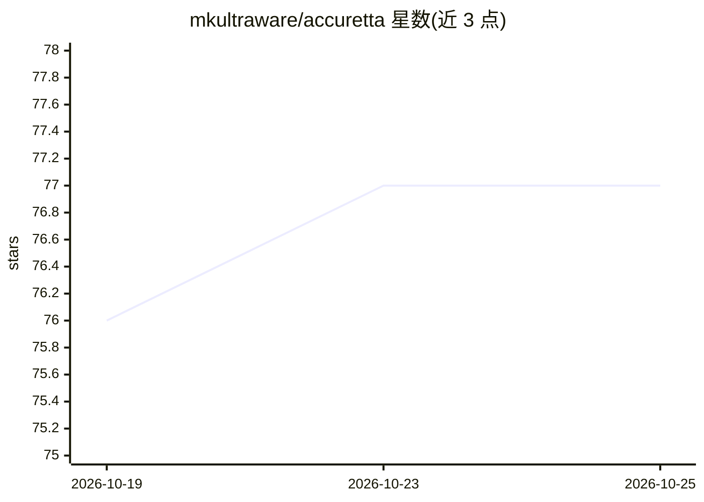

# mkultraware/accuretta

⭐ 77 · Python · NOASSERTION · 推送 2026-10-19 · [GitHub](https://github.com/mkultraware/accuretta) · [官网](https://www.sekura.se/accuretta) · 个人维护

**本地 GGUF 模型的桌面 agent 工作区与微型 IDE**

基于 llama.cpp 运行本地 GGUF 模型的桌面工作区：管理模型运行时（查找 GGUF、启动 llama-server、按硬件调参）、提供文件编辑、项目结构、持久终端、HTML 实时预览、Git 操作等工具，配合三档审批门控与 JSONL 审计记录。核心为静态 HTML/JS 加单个 Python bridge（标准库实现），可选包缺失时对应工具自动移除。另含 MCP 扩展加载、Tailscale 远程访问与授权红队工作流。许可为 personal use only。

## 筛选速览

| 维度 | 判定 | 备注 |
|---|---|---|
| AI 角色 | `ai-native` | 本体是模型或模型工具 |
| 许可风险 | `none` | NOASSERTION |
| 部署形态 | `desktop` | 安装包/桌面程序 |
| 模型依赖 | local-ok | 支持本地模型 |
| 硬件要求 | — | 无带数字的原话,不猜 |
| 安装摩擦 | `medium` | 含编译或系统依赖之一 |
| 成熟度 | — | 结构信号不足 |

## 能力要点

- 自动匹配 llama.cpp 构建并按 GGUF 元数据与 GPU 调参
- 文件/终端/预览/Git 的 agent 工作区与验证债务跟踪
- Soft/Medium/Hard 三档审批门控，审计写入 action_audit.jsonl
- 通过标准 JSON 配置加载 MCP server，支持 Discord 审批桥

## 适用场景

- 在自己 GPU 上运行本地模型并让其直接读写项目文件
- 带审批门槛地让 agent 执行命令与编辑代码
- 在断网/隐私要求下完成编码与本地分析任务

## 场景标签

`编码 Agent` · 领域:编码与开发

## 证据(README 行号)

> L5: **Run a GGUF model. Give it files, terminals, previews, and guardrails.**
> L14: Accuretta is a desktop workspace for local models running through llama.cpp. It puts chat history, file tools, pers
> L22: |Local model runtime|Finds GGUF files, launches llama-server, switches models, watches for crashes, and restores th

## 星数曲线

2026-10-19 76 → 2026-10-25 77（+1）

---
*卡片 v1 · prompt 1.4 · 生成 2026-10-24 · 置信度 mid · 依据 README sha `b4175f37e456` · [字段定义](../../DATASET.md)*
