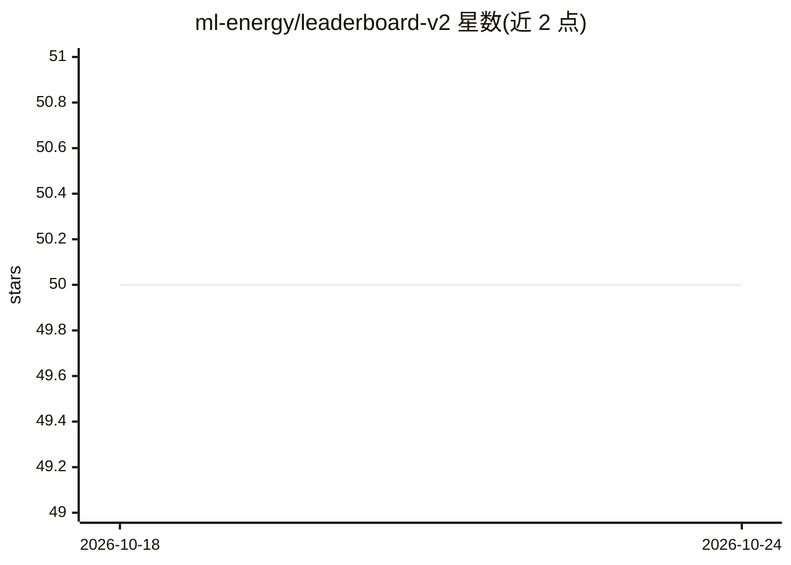

# ml-energy/leaderboard-v2

⭐ 50 · Python · Apache-2.0 · 推送 2025-11-29 · [GitHub](https://github.com/ml-energy/leaderboard-v2) · [官网](https://ml.energy/leaderboard/) · 组织维护

**GenAI 能耗基准测试与测量数据排行榜（V2，已弃用）**

ML.ENERGY Benchmark and Leaderboard V2 仓库，定位为生成式 AI 能耗基准测试与测量数据的来源，涵盖 LLM 等模型的能耗评测与排行。README 明确声明该 V2 版本已弃用，项目已完全升级到 V3，并引导用户前往新的 Benchmark 仓库与新版 Leaderboard。可见内容仅含弃用公告，不含安装或使用说明。

## 筛选速览

| 维度 | 判定 | 备注 |
|---|---|---|
| AI 角色 | `ai-knowledge` | 知识聚合/清单类 |
| 许可风险 | `permissive` | Apache-2.0 |
| 部署形态 | `None` |  |
| 模型依赖 | — | README 未给出锁定关系 |
| 硬件要求 | — | 无带数字的原话,不猜 |
| 安装摩擦 | `low` | 无编译、无系统依赖或容器化 |
| 成熟度 | — | 结构信号不足 |

## 能力要点

- 提供 GenAI 模型能耗基准测试与测量数据
- 以排行榜形式呈现评测结果
- README 声明已升级至 V3，V2 弃用

## 适用场景

- 查询各代 AI 模型的能耗测量数据（需注意 V2 已弃用）
- 模型选型时参考能耗评测排行

## 场景标签

`模型评测` · 领域:评测与运维

## 证据(README 行号)

> L1: # The ML.ENERGY Benchmark & Leaderboard V2 (deprecated)

## 星数曲线

2026-10-18 50 → 2026-10-24 50（+0）

---
*卡片 v1 · prompt 1.4 · 生成 2026-10-24 · 置信度 low · 依据 README sha `80f4634a119f` · [字段定义](../../DATASET.md)*
