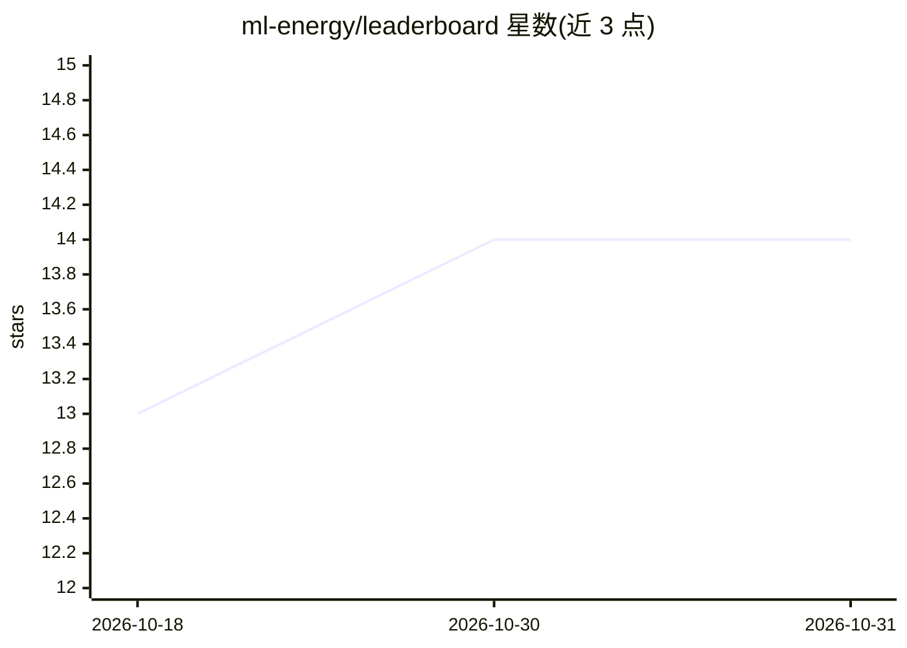

# ml-energy/leaderboard

⭐ 14 · TypeScript · 推送 2026-09-23 · [GitHub](https://github.com/ml-energy/leaderboard) · [官网](https://ml.energy/leaderboard) · 组织维护

**展示生成式 AI 模型能耗基准测试结果的网页排行榜源码**

The ML.ENERGY Leaderboard 的源码仓库，提供展示 ML.ENERGY 基准测试结果的网页排行榜。工作流为：先运行基准测试收集结果，再借助 ML.ENERGY Data Toolkit（pip 安装 mlenergy-data 或通过 uv run 使用）执行 build_data.py 生成排行榜数据，支持从本地已编译数据目录或自行运行的原始结果数据构建；网页部分用 npm install / npm run dev 预览。面向关注生成式模型推理能耗与功耗的开发者与研究者，附 NeurIPS Datasets and Benchmarks 2025 论文引用条目。

## 筛选速览

| 维度 | 判定 | 备注 |
|---|---|---|
| AI 角色 | `ai-ecosystem` | LLM/agent 周边工具 |
| 许可风险 | `none` | — |
| 部署形态 | `library` | 以包/库形式分发 |
| 模型依赖 | — | README 未给出锁定关系 |
| 硬件要求 | — | 无带数字的原话,不猜 |
| 安装摩擦 | `low` | 无编译、无系统依赖或容器化 |
| 成熟度 | — | 结构信号不足 |

## 能力要点

- 网页排行榜展示 ML.ENERGY 基准的推理能耗测试结果
- 通过 build_data.py 与 mlenergy-data 工具链构建数据
- 支持从本地编译数据或原始结果数据构建数据

## 适用场景

- 查阅各生成式 AI 模型的推理时间与能耗结果
- 基于源码自行部署本地排行榜实例
- 在自测基准数据上生成并展示排行榜

## 场景标签

`模型评测` · 领域:评测与运维

## 证据(README 行号)

> L3: Source code for The ML.ENERGY Leaderboard, which is a web leaderboard that displays results of The ML.ENERGY benchma
> L31:     title={The {ML.ENERGY Benchmark}: Toward Automated Inference Energy Measurement and Optimization},

## 星数曲线

2026-10-18 13 → 2026-10-31 14（+1）

---
*卡片 v1 · prompt 1.4 · 生成 2026-10-31 · 置信度 mid · 依据 README sha `9a5945bfd5d8` · [字段定义](../../DATASET.md)*
