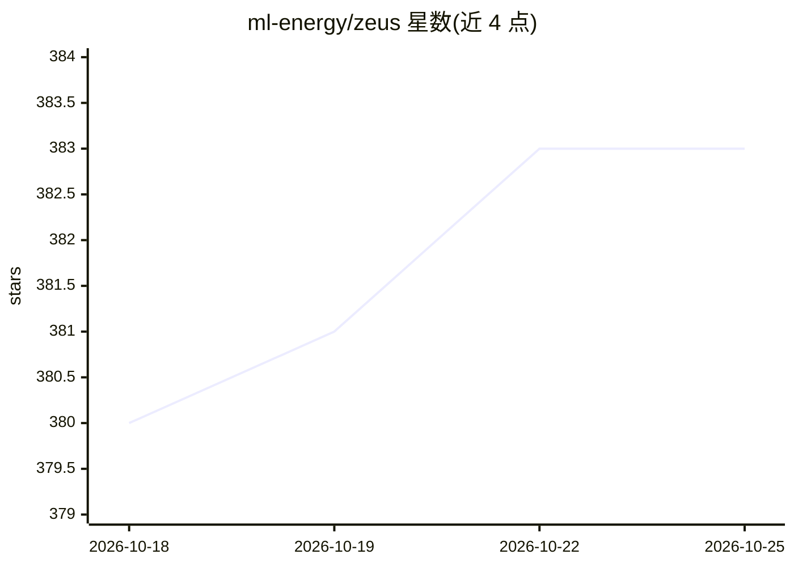

# ml-energy/zeus

⭐ 383 · Python · Apache-2.0 · 推送 2026-10-21 · [GitHub](https://github.com/ml-energy/zeus) · [官网](https://ml.energy/zeus) · 组织维护

**深度学习工作负载的能耗测量与优化库**

Zeus 是一个 Python 库（含 zeusd Rust 守护进程），用于测量与优化深度学习工作负载的能耗：支持 CPU、DRAM、AMD GPU、Apple Silicon 与 NVIDIA Jetson 平台的能量/功率测量，提供程序化 API 与 CLI，并为大模型训练优化提供 Perseus 等研究组件。面向从事 ML 训练/推理的工程师与科研人员，源自多篇顶会论文（NSDI 23、SOSP 24 等），是 PyTorch 生态项目。以 pip/crates.io/Docker 镜像分发，另附示例与 AI 编码 agent 技能包。

## 筛选速览

| 维度 | 判定 | 备注 |
|---|---|---|
| AI 角色 | `ai-ecosystem` | LLM/agent 周边工具 |
| 许可风险 | `permissive` | Apache-2.0 |
| 部署形态 | `self-host` | docker 或自建部署 |
| 模型依赖 | — | README 未给出锁定关系 |
| 硬件要求 | — | 无带数字的原话,不猜 |
| 安装摩擦 | `low` | 无编译、无系统依赖或容器化 |
| 成熟度 | — | 结构信号不足 |

## 能力要点

- 支持 CPU/DRAM/AMD GPU/Apple Silicon/Jetson 能量测量
- 程序化 API 与 CLI 两种测量方式
- PyTorch 生态项目，根植于 NSDI 23/SOSP 24 等多篇论文
- 提供含全部依赖的 Docker 镜像与示例代码

## 适用场景

- 我在训练模型时想量化和记录 GPU 能耗
- 我想优化训练/推理任务的能效
- 我想让 AI 编码助手学会用 Zeus 测量能耗

## 场景标签

`MLOps` · 领域:训练与推理

## 证据(README 行号)

> L21: Zeus is a library for (1) **measuring** the energy consumption of Deep Learning workloads and (2) **optimizing** th
> L16: - \[2025/05\] Zeus now supports CPU, DRAM, AMD GPU, Apple Silicon, and NVIDIA Jetson platform energy measurement!

## 星数曲线

2026-10-18 380 → 2026-10-25 383（+3）

---
*卡片 v1 · prompt 1.4 · 生成 2026-10-21 · 置信度 high · 依据 README sha `80372ca8c6bc` · [字段定义](../../DATASET.md)*
