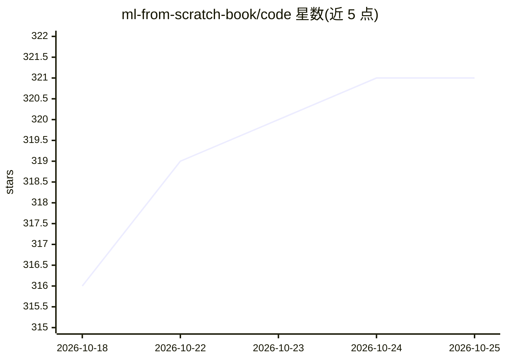

# ml-from-scratch-book/code

⭐ 322 · Jupyter Notebook · MIT · 推送 2026-07-19 · [GitHub](https://github.com/ml-from-scratch-book/code) · [官网](https://ml-from-scratch-book.github.io/code/) · 组织维护

**《Machine Learning From Scratch》书籍配套代码：从零实现10种核心ML算法**

书籍《Machine Learning From Scratch》的配套代码仓库，面向具备基础 Python 与高中数学的学习者。以直觉—形式化—NumPy 实现—测试—实践的 5 阶段框架，从零实现线性回归、逻辑回归、正则化、KNN、朴素贝叶斯、决策树、随机森林、梯度提升、XGBoost、神经网络共 10 种核心 ML 算法，并在真实数据上与 Scikit-learn、PyTorch 对比验证。内容还涵盖数学基础、数据准备与建模评估流程。代码以笔记本形式提供，可本地克隆运行或直接在 Google Colab 打开。

## 筛选速览

| 维度 | 判定 | 备注 |
|---|---|---|
| AI 角色 | `ai-knowledge` | 知识聚合/清单类 |
| 许可风险 | `permissive` | MIT |
| 部署形态 | `library` | 以包/库形式分发 |
| 模型依赖 | — | README 未给出锁定关系 |
| 硬件要求 | — | 无带数字的原话,不猜 |
| 安装摩擦 | `low` | 无编译、无系统依赖或容器化 |
| 成熟度 | — | 结构信号不足 |

## 能力要点

- 10 种核心 ML 算法的 NumPy 从零实现
- 5 阶段教学框架（直觉/形式化/实现/测试/实践）
- 与 Scikit-learn、PyTorch 工业标准库对比验证
- 每章笔记本可免本地环境直接在 Google Colab 打开

## 适用场景

- 跟着书籍逐章运行与复现算法实现
- 理解 fit()/predict() 背后的算法原理
- 在 Colab 上零配置学习从零实现的 ML 代码

## 场景标签

`教程课程` · 领域:学习与行业

## 证据(README 行号)

> L6: Companion code repository for Machine Learning From Scratch.
> L14: 3. **Implementation**: Put the math into clean, from-scratch code using NumPy.
> L55: The heart of the book — 10 core ML algorithms each built from scratch using the 5-stage framework:

## 星数曲线

2026-10-18 316 → 2026-10-25 321（+5）

---
*卡片 v1 · prompt 1.4 · 生成 2026-10-21 · 置信度 mid · 依据 README sha `cc91eb43a338` · [字段定义](../../DATASET.md)*
