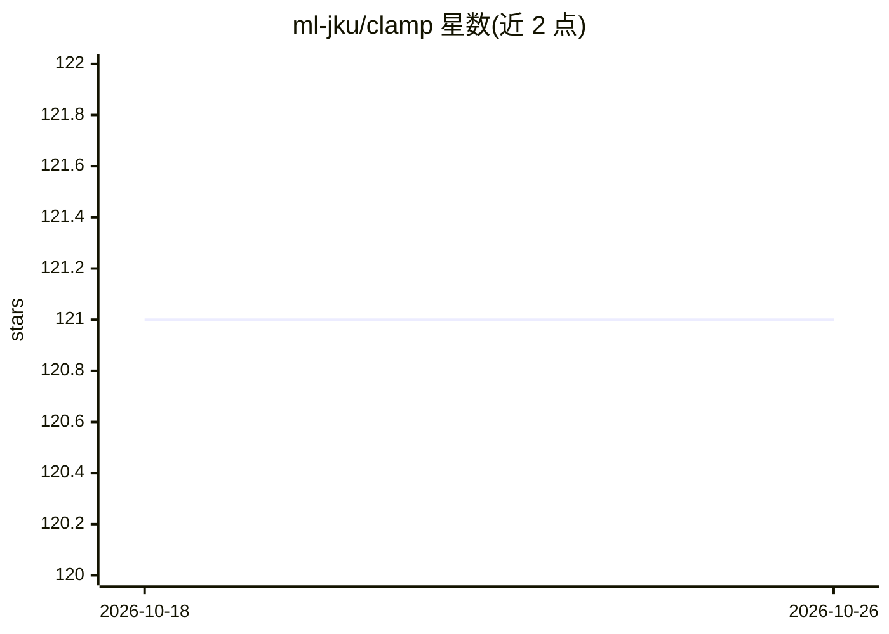

# ml-jku/clamp

⭐ 121 · Python · NOASSERTION · 推送 2026-02-26 · [GitHub](https://github.com/ml-jku/clamp) · [官网](https://arxiv.org/abs/2303.03363) · 组织维护

**药物发现中的生物活性预测模型，用自然语言指令零样本筛选分子**

论文 Enhancing Activity Prediction Models in Drug Discovery with the Ability to Understand Human Language 的官方代码：CLAMP 在分子-生物实验描述对上做对比预训练，可接收生物实验的自然语言描述，在无训练样本（零样本/少样本）条件下预测最相关的分子。仓库提供预训练模型权重、FS-Mol/PubChem 数据集的预处理与编码脚本、训练与线性探测流程，以及 Colab 演示；复现需下载预处理数据集，编码步骤可指定 GPU。以 Python 包与 conda 环境方式安装。

## 筛选速览

| 维度 | 判定 | 备注 |
|---|---|---|
| AI 角色 | `ai-native` | 本体是模型或模型工具 |
| 许可风险 | `none` | NOASSERTION |
| 部署形态 | `desktop` | 安装包/桌面程序 |
| 模型依赖 | — | README 未给出锁定关系 |
| 硬件要求 | — | 无带数字的原话,不猜 |
| 安装摩擦 | `medium` | 含编译或系统依赖之一 |
| 成熟度 | — | 结构信号不足 |

## 能力要点

- 分子-生物实验描述对比预训练，支持自然语言指令的零样本分子预测
- 提供预训练模型权重（含 Frequent Hitter 基线）与 Colab 演示
- 覆盖 FS-Mol/PubChem/MoleculeNet 数据集的预处理、编码与训练/线性探测脚本

## 适用场景

- 用自然语言描述生物实验，零样本预测最相关分子
- 少样本药物发现基准上训练活性预测模型
- 用 CLAMP 编码做分子性质预测的线性探测

## 场景标签

 · 领域:药物发现/机器学习

## 证据(README 行号)

> L7: CLAMP (Contrastive Language-Assay Molecule Pre-Training) is trained on molecule-bioassay pairs. It can be instructed
> L135: Drug Discovery, Machine Learning, Zero-shot, NLP, LLM, Scientific Language Model

## 星数曲线

2026-10-18 121 → 2026-10-26 121（+0）

---
*卡片 v1 · prompt 1.4 · 生成 2026-10-23 · 置信度 high · 依据 README sha `f1ad3e617bdf` · [字段定义](../../DATASET.md)*
