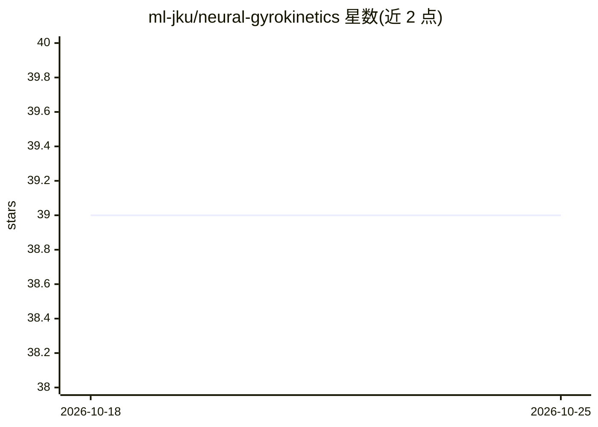

# ml-jku/neural-gyrokinetics

⭐ 39 · Jupyter Notebook · MIT · 推送 2026-10-07 · [GitHub](https://github.com/ml-jku/neural-gyrokinetics) · [官网](https://ml-jku.github.io/blog/2025/gyroswin/) · 组织维护

**加速等离子体湍流模拟的机器学习研究代码集合**

由 JKU 机器学习团队维护的科学机器学习与回旋动理学交叉研究代码库，包含四个组件：GyroSwin（预测非线性回旋动理学的 5D 视觉 Transformer 代理模型）、PINC（保留物理诊断的等离子体数据物理信息神经压缩，压缩比可达 70,000x）、基于隐空间流匹配的扩散生成采样，以及可微分 JAX 回旋动理学求解器 gyaradax（用于物理损失与 PINN 残差基线）。模型权重与数据集托管在 Hugging Face Hub。实验通过 Hydra 配置与 main.py 运行，面向等离子体物理与科学机器学习方向的研究者，含 NeurIPS 2025 论文引用信息。

## 筛选速览

| 维度 | 判定 | 备注 |
|---|---|---|
| AI 角色 | `ai-native` | 本体是模型或模型工具 |
| 许可风险 | `permissive` | MIT |
| 部署形态 | `None` |  |
| 模型依赖 | — | README 未给出锁定关系 |
| 硬件要求 | — | 无带数字的原话,不猜 |
| 安装摩擦 | `low` | 无编译、无系统依赖或容器化 |
| 成熟度 | — | 结构信号不足 |

## 能力要点

- GyroSwin：5D shifted-window 线性注意力代理模型，预测湍流输运
- PINC：保留物理诊断的神经压缩，压缩比可达 70,000x
- gyaradax：可微分 JAX 回旋动理学右端项求解器
- 模型检查点与数据集托管于 Hugging Face Hub，支持自回归推理脚本

## 适用场景

- 用代理模型替代高维等离子体湍流模拟以降低计算成本
- 压缩与复现回旋动理学湍流轨迹数据
- 从训练好的扩散检查点生成采样轨迹

## 场景标签

`科研工具` · 领域:学习与行业

## 证据(README 行号)

> L3: Machine learning tools to accelerate and compress high-dimensional plasma turbulence simulations. A growing collecti
> L5: - GyroSwin Icon GyroSwin : a 5D neural surrogate for nonlinear gyrokinetics. blogpost
> L12: ## Who is this for?

## 星数曲线

2026-10-18 39 → 2026-10-25 39（+0）

---
*卡片 v1 · prompt 1.4 · 生成 2026-10-25 · 置信度 high · 依据 README sha `a04bef52ccd8` · [字段定义](../../DATASET.md)*
