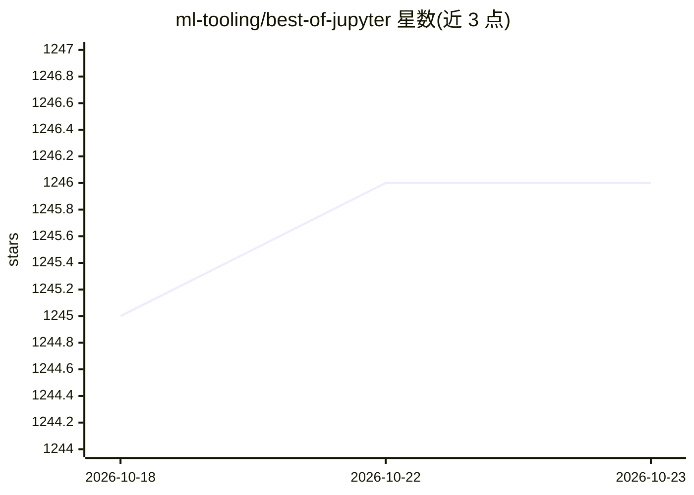

# ml-tooling/best-of-jupyter

⭐ 1,246 · CC-BY-SA-4.0 · 推送 2026-10-22 · [GitHub](https://github.com/ml-tooling/best-of-jupyter) · 组织维护

**Jupyter 生态开源项目排名清单（300 个项目，13 类）**

由 ml-tooling 维护的 Jupyter 项目策展清单：收录 300 个开源项目（合计 420K stars），按笔记本环境、交互组件与可视化等 13 个类别组织。所有项目按项目质量分数排名，该分数基于从 GitHub 和各包管理器自动采集的指标（star、贡献者、下载量、依赖数等）计算。每条目附许可证、安装命令与趋势/活跃度标记（新项目、不活跃、停更等），每周更新，用户可通过 issue、PR 或编辑 projects.yaml 参与贡献。

## 筛选速览

| 维度 | 判定 | 备注 |
|---|---|---|
| AI 角色 | `ai-knowledge` | 知识聚合/清单类 |
| 许可风险 | `viral` | CC-BY-SA-4.0 |
| 部署形态 | `self-host` | docker 或自建部署 |
| 模型依赖 | — | README 未给出锁定关系 |
| 硬件要求 | — | 无带数字的原话,不猜 |
| 安装摩擦 | `low` | 无编译、无系统依赖或容器化 |
| 成熟度 | — | 结构信号不足 |

## 能力要点

- 收录 300 个项目、13 个类别的分类组织
- 基于 GitHub 与包管理器多指标自动计算质量排名
- 活跃度标记：新项目/不活跃（6个月）/停更（12个月）/趋势升降
- 每周更新，通过 projects.yaml 开放社区贡献

## 适用场景

- 为数据分析工作挑选 Jupyter 扩展、内核与工具
- 了解 Jupyter 生态各项目的活跃度与许可证状态
- 发现可替代已停更项目的候选工具

## 场景标签

`精选清单` · 领域:学习与行业

## 证据(README 行号)

> L3:  🏆&nbsp; A ranked list of awesome Jupyter projects. Updated weekly.
> L5: This curated list contains 300 awesome open-source projects with a total of 420K stars grouped into 13 categories. A

## 星数曲线

2026-10-18 1,245 → 2026-10-23 1,246（+1）

---
*卡片 v1 · prompt 1.4 · 生成 2026-10-21 · 置信度 mid · 依据 README sha `76871c9b42d1` · [字段定义](../../DATASET.md)*
