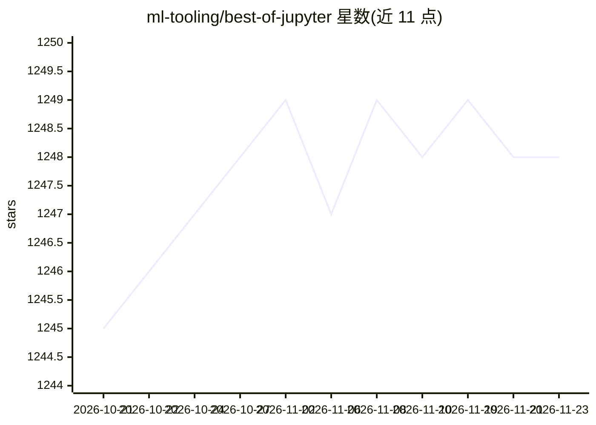

# ml-tooling/best-of-jupyter

⭐ 1,248 · CC-BY-SA-4.0 · 推送 2026-11-19 · [GitHub](https://github.com/ml-tooling/best-of-jupyter) · 组织维护

**Jupyter 生态项目排名清单：300 个项目每周自动更新**

由 best-of 生成器自动维护的 Jupyter 项目目录，收录 300 个开源项目、共 420K stars，按 notebook 环境、交互组件与可视化等 13 个类别组织。每个项目依据从 GitHub 和包管理器自动采集的多项指标计算质量分并排序，标注 star 数、贡献者、下载量、依赖项目数、活跃状态（新增/不活跃/死亡）与许可证信息，每周更新，接受 issue、PR 与直接编辑 projects.yaml 的贡献。

## 筛选速览

| 维度 | 判定 | 备注 |
|---|---|---|
| AI 角色 | `ai-knowledge` | 知识聚合/清单类 |
| 许可风险 | `viral` | CC-BY-SA-4.0 |
| 部署形态 | `self-host` | docker 或自建部署 |
| 模型依赖 | — | README 未给出锁定关系 |
| 硬件要求 | — | 无带数字的原话,不猜 |
| 安装摩擦 | `low` | 无编译、无系统依赖或容器化 |
| 成熟度 | — | 结构信号不足 |

## 能力要点

- 300 个项目按自动计算的质量分排序，每周更新
- 13 个类别覆盖 notebook 环境、内核、扩展、组件与工具
- 标注 star/下载/依赖数、活跃状态与许可证风险标记
- 可通过 issue/PR/编辑 projects.yaml 参与贡献

## 适用场景

- 为数据科学工作流挑选 Jupyter 环境与扩展
- 查找特定类别的 Jupyter 内核或可视化组件
- 评估某 Jupyter 周边项目的活跃度与许可证状况

## 场景标签

`精选清单` · 领域:学习与行业

## 证据(README 行号)

> L3:  🏆&nbsp; A ranked list of awesome Jupyter projects. Updated weekly.
> L5: This curated list contains 300 awesome open-source projects with a total of 420K stars grouped into 13 categories. A

## 星数曲线

2026-10-21 1,245 → 2026-11-23 1,248（+3）

---
*卡片 v1 · prompt 1.4 · 生成 2026-11-23 · 置信度 mid · 依据 README sha `612c53b8f081` · [字段定义](../../DATASET.md)*
