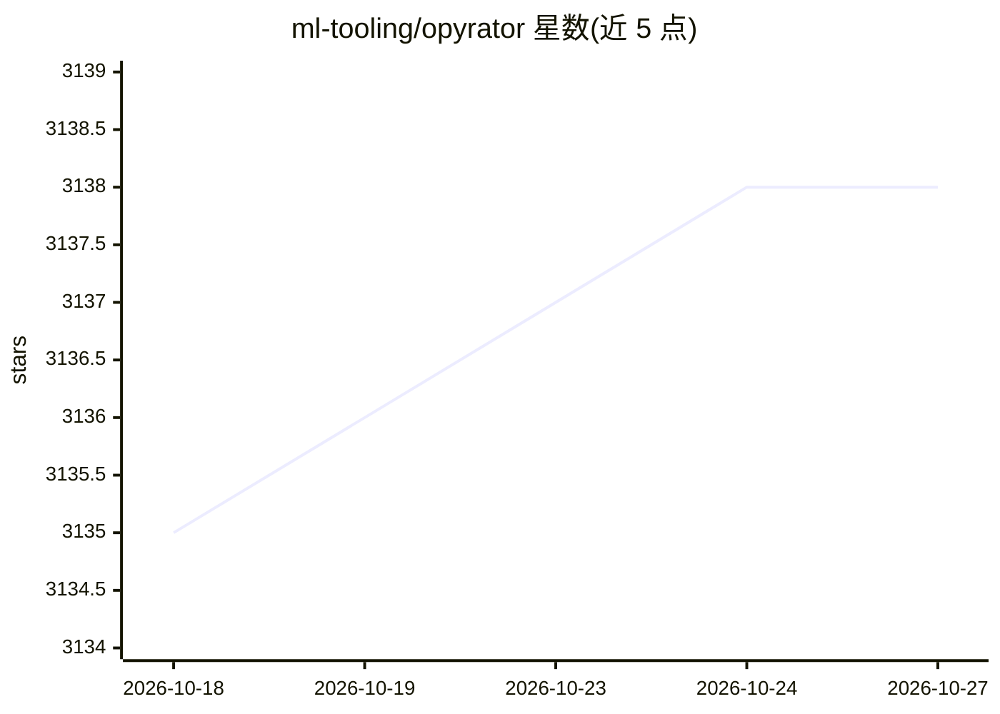

# ml-tooling/opyrator

⭐ 3,138 · Python · MIT · 推送 2026-10-23 · [GitHub](https://github.com/ml-tooling/opyrator) · [官网](https://opyrator-playground.mltooling.org) · 组织维护

**把 Python 函数一键变成带 Web API 与 GUI 的微服务**

面向 Python 开发者的代码产品化工具：将符合规范的函数（Pydantic 输入输出模型、类型注解）自动生成为 FastAPI HTTP API 和 Streamlit 交互式 UI，也可经 CLI 调用。支持导出为自包含 zip 文件或 Docker 镜像以便分享与部署。基于 OpenAPI、JSON Schema 与 Python 类型提示等开放标准。README 声明为 Alpha 版本，仅建议实验性使用；维护者为三人团队，不提供邮件单独支持。

## 筛选速览

| 维度 | 判定 | 备注 |
|---|---|---|
| AI 角色 | `ai-ecosystem` | LLM/agent 周边工具 |
| 许可风险 | `permissive` | MIT |
| 部署形态 | `self-host` | docker 或自建部署 |
| 模型依赖 | — | README 未给出锁定关系 |
| 硬件要求 | — | 无带数字的原话,不猜 |
| 安装摩擦 | `low` | 无编译、无系统依赖或容器化 |
| 成熟度 | `idea` | |

## 能力要点

- 由函数自动生成 FastAPI HTTP API 与 Streamlit Web UI
- 可导出为自包含 zip 文件或 Docker 镜像分享部署
- CLI 调用方式，支持从本地函数、zip 包或运行中的 API 端点执行
- zip 导出自动发现 Pipfile/environment.yml/requirements.txt 等依赖声明

## 适用场景

- 快速把机器学习函数包装成 HTTP API 或交互式界面
- 将 Python 函数打包为可分享的自包含文件或 Docker 镜像
- 为演示或原型快速生成交互式 Web UI

## 场景标签

 · 领域:MLOps/开发工具

## 证据(README 行号)

> L13: Instantly turn your Python functions into production-ready microservices. Deploy and access your services via HTTP 
> L22: - 🔌&nbsp; Auto-generated HTTP API based on FastAPI.
> L23: - 🌅&nbsp; Auto-generated Web UI based on Streamlit.

## 星数曲线

2026-10-18 3,135 → 2026-10-27 3,138（+3）

---
*卡片 v1 · prompt 1.4 · 生成 2026-10-20 · 置信度 high · 依据 README sha `29f704d1b575` · [字段定义](../../DATASET.md)*
