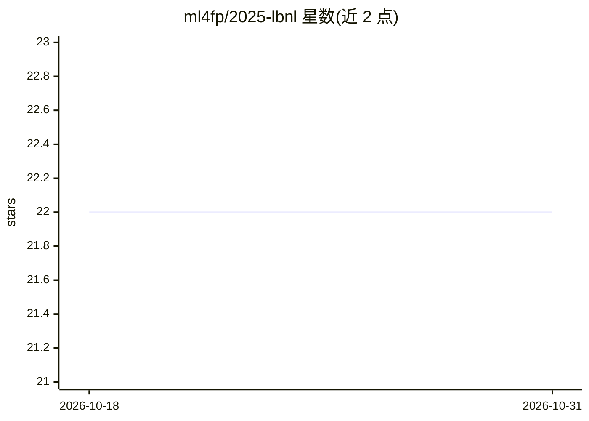

# ml4fp/2025-lbnl

⭐ 22 · Jupyter Notebook · MIT · 推送 2026-02-13 · [GitHub](https://github.com/ml4fp/2025-lbnl) · [官网](https://ml4fp.github.io/2025-lbnl/) · 组织维护

**粒子物理机器学习学校（ML4FP 2025）教程 notebook 仓库**

汇集 2025 年 8 月 4-8 日在劳伦斯伯克利国家实验室举办的 Machine Learning for Fundamental Physics (ML4FP) 学校所用的讲演与教程 notebook。活动面向粒子物理学研究者开放，可现场或线上注册参加；NERSC 为注册学员提供带 GPU 节点的训练账号，另设 ATLAS、CMS、DUNE 专题并行环节。主题标签涉及异常检测、可微编程、GNN、模拟推断等方向。

## 筛选速览

| 维度 | 判定 | 备注 |
|---|---|---|
| AI 角色 | `ai-knowledge` | 知识聚合/清单类 |
| 许可风险 | `permissive` | MIT |
| 部署形态 | `None` |  |
| 模型依赖 | — | README 未给出锁定关系 |
| 硬件要求 | — | 无带数字的原话,不猜 |
| 安装摩擦 | `low` | 无编译、无系统依赖或容器化 |
| 成熟度 | — | 结构信号不足 |

## 能力要点

- 学校官方教程 notebook 汇集
- 主题覆盖异常检测、GNN、可微编程、simulation-based-inference 等
- NERSC 为学员提供 GPU 训练账号
- 含 ATLAS/CMS/DUNE 专题环节

## 适用场景

- 粒子物理研究者学习 ML 方法与教程
- 回顾 ML4FP 2025 学校的课程内容

## 场景标签

`教程课程` · 领域:学习与行业

## 证据(README 行号)

> L1: # Machine Learning for Fundamental Physics (ML4FP) School 2025

## 星数曲线

2026-10-18 22 → 2026-10-31 22（+0）

---
*卡片 v1 · prompt 1.4 · 生成 2026-10-27 · 置信度 high · 依据 README sha `7567b5fc31ca` · [字段定义](../../DATASET.md)*
