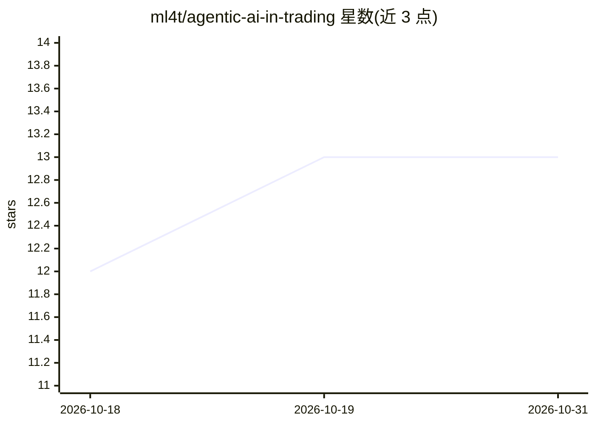

# ml4t/agentic-ai-in-trading

⭐ 13 · Jupyter Notebook · MIT · 推送 2026-09-24 · [GitHub](https://github.com/ml4t/agentic-ai-in-trading) · 组织维护

**交易研讨会材料：编码 agent 写的预测流水线及其实证审计**

QuantInsti 算法交易会议 2026 开场研讨会材料。内容为：一个编码 agent 依据研究简报与每日 ETF 价格面板写出完整预测流水线（数据加载、特征、标签、模型、评估），仓库保存其未编辑的代码、四次运行的转录与环境记录，以及一个复现并逐行改动检验结果的 notebook。四个运行在同一模型、容器与数据下比较不同简报与仓库设置的效果；附 CHECKLIST.md 六项研究检查。notebook 可在 Colab 免安装运行，本地需 Python 3.12 与 uv，价格数据由脚本从 Yahoo Finance 下载。

## 筛选速览

| 维度 | 判定 | 备注 |
|---|---|---|
| AI 角色 | `ai-knowledge` | 知识聚合/清单类 |
| 许可风险 | `permissive` | MIT |
| 部署形态 | `None` |  |
| 模型依赖 | — | README 未给出锁定关系 |
| 硬件要求 | — | 无带数字的原话,不猜 |
| 安装摩擦 | `low` | 无编译、无系统依赖或容器化 |
| 成熟度 | — | 结构信号不足 |

## 能力要点

- 保存 agent 未编辑的预测流水线代码与四次完整运行记录（转录/diff/环境）
- notebook 复现结果并逐行改动观察结果变化
- 每次运行附 ENVIRONMENT.md 记录模型、容器镜像与数据校验和
- 提供六项研究完整性检查清单 CHECKLIST.md

## 适用场景

- 学习如何审计 AI agent 产出的量化研究代码
- 比较不同简报与仓库设置对 agent 研究产出质量的影响
- 在 Colab 或本地复现并检视 agent 的预测流水线

## 场景标签

`金融量化` `教程课程` · 领域:学习与行业

## 证据(README 行号)

> L6: A coding agent was given a research brief and a panel of daily ETF prices, and
> L8: model, an evaluation. This repository holds what it wrote, the transcript of the
> L15: **`notebooks/audit.ipynb`** explains what the strategy

## 星数曲线

2026-10-18 12 → 2026-10-31 13（+1）

---
*卡片 v1 · prompt 1.4 · 生成 2026-10-31 · 置信度 high · 依据 README sha `f46ed51a139c` · [字段定义](../../DATASET.md)*
