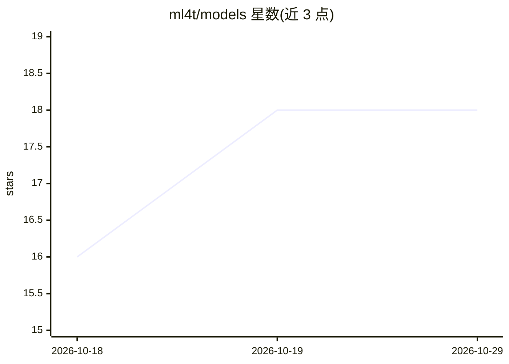

# ml4t/models

⭐ 18 · Python · MIT · 推送 2026-10-27 · [GitHub](https://github.com/ml4t/models) · [官网](https://www.ml4trading.io/docs/models/) · 组织维护

**面向实证资产定价与组合学习的金融专用模型库**

Python 库，为量化金融研究提供论文复现级模型族：潜在因子估计器（PCA/RPPCA/IPCA/CAE）、随机贴现因子建模、监督自编码器直接资产预测，以及线性特征/LSTM/DeePM 式端到端组合学习模型。围绕金融原生数据契约（PersistentPanelBatch、CrossSectionBatch、PortfolioSequenceBatch）组织，将结构提取、因子溢价预测、资产映射各步骤显式分离，输出衔接 ml4t-backtest 与 ml4t-diagnostic。基础包基于 NumPy，神经模型需安装 deep 扩展（Torch，限 Python 3.12-3.14）。

## 筛选速览

| 维度 | 判定 | 备注 |
|---|---|---|
| AI 角色 | `ai-native` | 本体是模型或模型工具 |
| 许可风险 | `permissive` | MIT |
| 部署形态 | `library` | 以包/库形式分发 |
| 模型依赖 | — | README 未给出锁定关系 |
| 硬件要求 | — | 无带数字的原话,不猜 |
| 安装摩擦 | `low` | 无编译、无系统依赖或容器化 |
| 成熟度 | — | 结构信号不足 |

## 能力要点

- PCA/RPPCA/IPCA/CAE 四类潜在因子估计器，输出结构性因子载荷与因子收益
- 监督自编码器 SAEModel 做直接资产收益预测
- 线性特征/LSTM/DeePM 式端到端组合配置学习
- 金融原生数据契约与显式结构/预测阶段分离，衔接回测与诊断库

## 适用场景

- 在实证资产定价研究中估计潜在因子并预测因子溢价
- 训练直接输出资产权重的组合学习模型
- 构建可衔接到 ml4t-backtest 回测流水线的信号模型

## 场景标签

`金融量化` · 领域:学习与行业

## 证据(README 行号)

> L7: Finance-specific models for asset pricing, prediction, and portfolio learning.
> L19: `ml4t-models` packages paper-faithful model families that are common in modern empirical asset pricing and portfoli

## 星数曲线

2026-10-18 16 → 2026-10-29 18（+2）

---
*卡片 v1 · prompt 1.4 · 生成 2026-10-29 · 置信度 high · 依据 README sha `554f5171eb35` · [字段定义](../../DATASET.md)*
