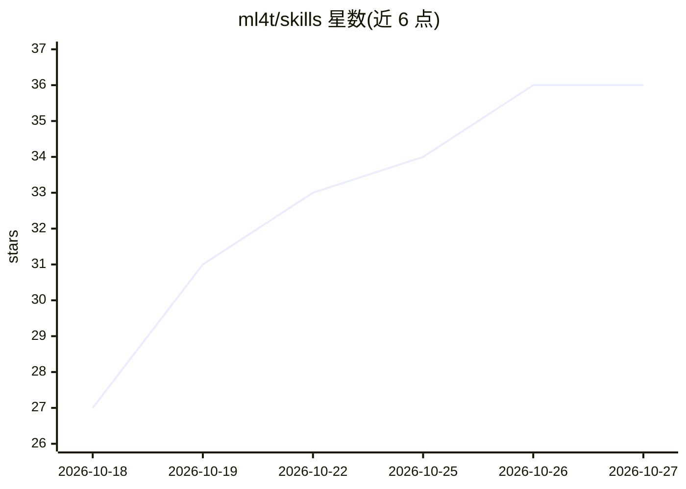

# ml4t/skills

⭐ 36 · Python · Apache-2.0 · 推送 2026-10-26 · [GitHub](https://github.com/ml4t/skills) · [官网](https://ml4trading.io) · 个人维护

**量化交易机器学习的 AI 编程助手技能集（61 条 SKILL.md）**

基于《Machine Learning for Algorithmic Trading（第3版）》构建的 61 个独立技能文件（SKILL.md + YAML frontmatter），将量化研究规范转化为 AI 编程助手的运行时指导，覆盖数据泄漏、前视偏差、回测过拟合、CPCV 交叉验证、交易成本建模、组合风险、agent 治理等 10 类主题。技能为纯 Markdown、无可执行脚本与网络调用，通过 scripts/install.sh 以符号链接方式安装到 agent 技能目录，兼容 Claude Code、Codex/OpenAI agents 等可读取本地技能文件的工具；部分技能可选对接 ml4t-* 生产库。

## 筛选速览

| 维度 | 判定 | 备注 |
|---|---|---|
| AI 角色 | `ai-knowledge` | 知识聚合/清单类 |
| 许可风险 | `permissive` | Apache-2.0 |
| 部署形态 | `library` | 以包/库形式分发 |
| 模型依赖 | — | README 未给出锁定关系 |
| 硬件要求 | — | 无带数字的原话,不猜 |
| 安装摩擦 | `low` | 无编译、无系统依赖或容器化 |
| 成熟度 | — | 结构信号不足 |

## 能力要点

- 61 个独立技能按概念/数据/特征/验证/回测/组合等 10 类组织
- 纯 Markdown 技能文件，无可执行脚本、无钩子、无网络调用
- install.sh 幂等安装，git pull 一次更新全部技能，支持 --copy/--prune/--uninstall
- 每条技能遵循 Problem→WRONG→CORRECT→Guardrails→Checklist 模式

## 适用场景

- 让 Claude Code/Codex 等编程助手在量化研究中避免泄漏与前视偏差等错误
- 为交易策略研究流程提供回测、验证与生产化的步骤指引
- 按章节对照学习量化 ML 的正确实践模式

## 场景标签

`金融量化` `提示工程` · 领域:Agent 开发

## 证据(README 行号)

> L5: 61 standalone skills that teach AI coding assistants the Machine Learning for Trading workflow from *Machine Learnin
> L9: Each skill is a plain `SKILL.md` file with YAML frontmatter and concise procedural guidance. Installing them means p

## 星数曲线

2026-10-18 27 → 2026-10-27 36（+9）

---
*卡片 v1 · prompt 1.4 · 生成 2026-10-25 · 置信度 mid · 依据 README sha `9e96a7bee88f` · [字段定义](../../DATASET.md)*
