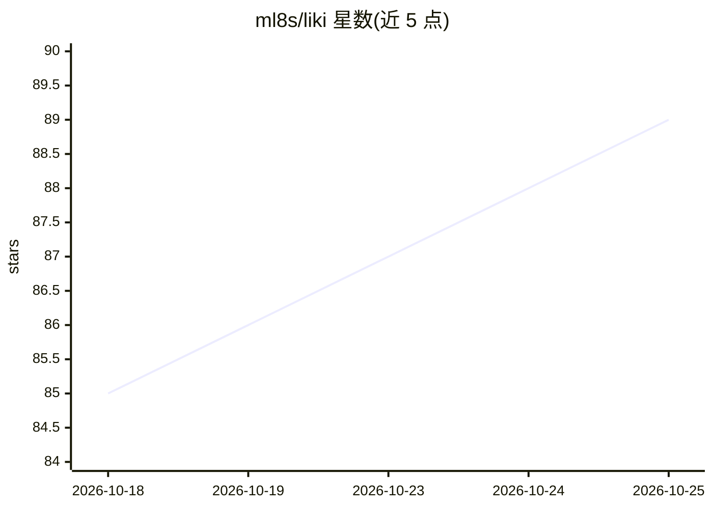

# ml8s/liki

⭐ 91 · Go · MIT · 推送 2026-10-25 · [GitHub](https://github.com/ml8s/liki) · [官网](https://liki.hk) · 个人维护 · 中文 README

**面向 AI agent 的专业命理 Skill：八字/紫微/六爻/奇门/择日/风水/起名**

以 npx skills 安装的命理 Skill，供命理咨询者、命理师与应用开发者通过对话获得排盘与断语。核心机制：排盘由天文历算引擎处理，与 lunar-python/sxtwl/bazi-calculator 三个开源实现对算（192 个节气边界案例）；断语来自 829 条规则真值表，每条带经典原文出处；考时为显式流程，列出候选并用真实事件校准。输出结构化 JSON 并附 SHA-256 摘要。需联网，通过 liki.hk 托管的 engine-mcp 与 counsel-mcp 两个 MCP 端点提供服务；城市地理编码可能调用 Nominatim，可自部署关闭。

## 筛选速览

| 维度 | 判定 | 备注 |
|---|---|---|
| AI 角色 | `ai-native` | 本体是模型或模型工具 |
| 许可风险 | `permissive` | MIT |
| 部署形态 | `library` | 以包/库形式分发 |
| 模型依赖 | — | README 未给出锁定关系 |
| 硬件要求 | — | 无带数字的原话,不猜 |
| 安装摩擦 | `low` | 无编译、无系统依赖或容器化 |
| 成熟度 | — | 结构信号不足 |

## 能力要点

- 排盘经 192 个节气边界案例与三个开源实现四方对算（all_oracles_must_agree）
- 829 条断语、893 个条件组的规则真值表，每条附经典出处
- 考时显式流程：候选集+原因，用真实事件校准，证据不足明说
- 输出结构化 JSON + SHA-256 摘要，标准 MCP 工具可接入产品

## 适用场景

- 想认真了解自己命盘的人直接问八字、起名、择日
- 命理师/内容创作者用同一工具获得一致盘面
- 应用开发者通过 MCP 与结构化 JSON 接入命理能力

## 场景标签

 · 领域:传统文化/命理服务

## 证据(README 行号)

> L70: npx skills add https://liki.hk
> L136: 需要。Skill 通过 liki.hk 托管的 `engine-mcp`（排盘）与 `counsel-mcp`（断语）两个 MCP 端点提供服务——安装即用，无需任何配置。

## 星数曲线

2026-10-18 85 → 2026-10-25 89（+4）

---
*卡片 v1 · prompt 1.4 · 生成 2026-10-24 · 置信度 mid · 依据 README sha `a7d46afe62e3` · [字段定义](../../DATASET.md)*
