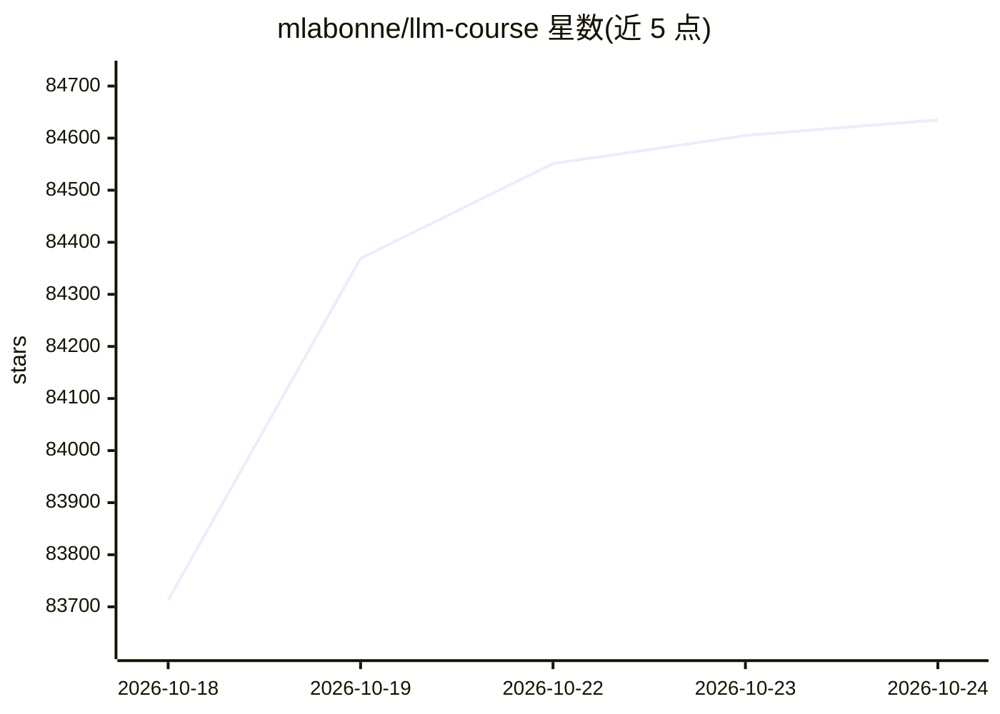

# mlabonne/llm-course

⭐ 84,658 · Apache-2.0 · 推送 2026-02-05 · [GitHub](https://github.com/mlabonne/llm-course) · [官网](https://mlabonne.github.io/blog/) · 个人维护

**面向 LLM 学习者的三阶段课程：路线图与 Colab 笔记本**

按三部分组织的学习路线：LLM Fundamentals（数学、Python、神经网络、NLP 基础）、The LLM Scientist（构建模型的技术）、The LLM Engineer（构建与部署 LLM 应用）。作者附赠一组可运行的 Colab 笔记本，覆盖自动评估、模型合并、云上微调（Unsloth/Axolotl/TRL）、量化（GGUF/GPTQ/EXL2/AWQ/HQQ）、去重与消融等工具流程，并配套文章与基于该课程合著的 LLM Engineer's Handbook。课程本身声明永久免费。

## 筛选速览

| 维度 | 判定 | 备注 |
|---|---|---|
| AI 角色 | `ai-knowledge` | 知识聚合/清单类 |
| 许可风险 | `permissive` | Apache-2.0 |
| 部署形态 | `None` |  |
| 模型依赖 | — | README 未给出锁定关系 |
| 硬件要求 | — | 无带数字的原话,不猜 |
| 安装摩擦 | `low` | 无编译、无系统依赖或容器化 |
| 成熟度 | — | 结构信号不足 |

## 动量与使用信号

- 维护:`declining` — 距上次 push 254.8 天,年发版 0,3 位贡献者
- 涨星:近 1 天 **+86**(自 20261016 起算)
- 平台:— · 协议:MCP / OLLAMA

## 能力要点

- 三部分路线图：基础、LLM Scientist、LLM Engineer
- 8 个自动化工具笔记本（LLM AutoEval、LazyMergekit、AutoQuant 等）
- 6 个微调教程笔记本覆盖 Llama/Mistral/CodeLlama
- 量化教程覆盖 GGUF、GPTQ、EXL2、AWQ、HQQ 格式

## 适用场景

- 系统学习大语言模型从数学基础到应用部署的路线
- 在 Google Colab 中一键运行微调、合并、量化笔记本
- 查找微调与量化技术的入门文章与资源清单

## 场景标签

`教程课程` `微调` `模型量化` · 领域:学习与行业

## 证据(README 行号)

> L8: LLM EngineerThe LLM course is divided into three parts:
> L21: A list of notebooks and articles I wrote about LLMs.
> L29: |🧐 LLM AutoEval|Automatically evaluate your LLMs using RunPod|Open In Colab|

## 星数曲线

2026-10-18 83,713 → 2026-10-24 84,635（+922）

---
*卡片 v1 · prompt 1.4 · 生成 2026-10-18 · 置信度 high · 依据 README sha `a00599a59470` · [字段定义](../../DATASET.md)*
