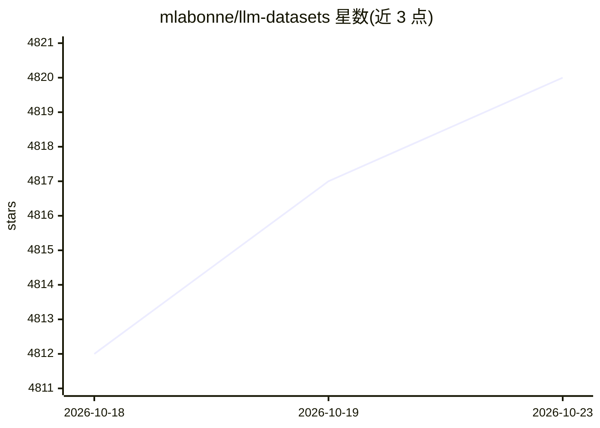

# mlabonne/llm-datasets

⭐ 4,820 · 推送 2026-04-29 · [GitHub](https://github.com/mlabonne/llm-datasets) · [官网](https://mlabonne.github.io/blog) · 个人维护

**面向 LLM 后训练的精选数据集与工具清单，按任务领域分类**

由 mlabonne 维护的后训练（SFT/偏好）数据集策展清单：按通用、数学、科学、代码、指令遵循、多语言、Agent 与函数调用、真实对话等类别组织条目，每个条目标注样本量、是否含推理轨迹（Thinking）、许可证与来源说明。清单还给出高质量数据集的三项标准（准确性、多样性、复杂性）与质量保障手段（人工审查、规则过滤、judge LLM 评分）。条目多为 Hugging Face 上的公开数据集，默认标注宽松许可证，例外单独注明。无安装或运行方式，属于阅读参考型资源。

## 筛选速览

| 维度 | 判定 | 备注 |
|---|---|---|
| AI 角色 | `ai-knowledge` | 知识聚合/清单类 |
| 许可风险 | `none` | — |
| 部署形态 | `None` |  |
| 模型依赖 | — | README 未给出锁定关系 |
| 硬件要求 | — | 无带数字的原话,不猜 |
| 安装摩擦 | `low` | 无编译、无系统依赖或容器化 |
| 成熟度 | — | 结构信号不足 |

## 能力要点

- 按 8+ 个后训练任务领域分类组织数据集条目
- 每条标注样本量、推理轨迹（Thinking）、许可证与来源
- 给出高质量数据集的三项标准与质量保障技术说明
- 条目默认宽松许可证（Apache 2.0/MIT/CC-BY-4.0 等），例外单独标注

## 适用场景

- 为 SFT/后训练挑选各领域公开数据集
- 查找含推理轨迹的数学、代码、Agent 数据
- 了解数据集质量评估与筛选的常用做法

## 场景标签

`精选清单` · 领域:学习与行业

## 证据(README 行号)

> L8:  Curated list of datasets and tools for post-training.
> L20: ## 📅 Instruction Datasets

## 星数曲线

2026-10-18 4,812 → 2026-10-23 4,820（+8）

---
*卡片 v1 · prompt 1.4 · 生成 2026-10-20 · 置信度 high · 依据 README sha `8cf71cea6b08` · [字段定义](../../DATASET.md)*
