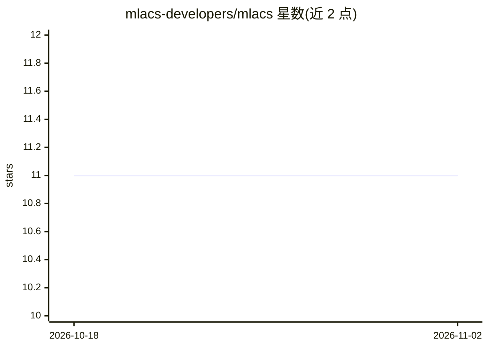

# mlacs-developers/mlacs

⭐ 11 · Python · NOASSERTION · 推送 2026-03-04 · [GitHub](https://github.com/mlacs-developers/mlacs) · [官网](https://mlacs.readthedocs.io/) · 组织维护

**机器学习辅助的原子体系有限温度模拟 Python 库，面向热力学性质计算**

MLACS 是一个 Python 包，将机器学习势与原子体系的量子模拟结合，用于有限温度模拟与热力学性质计算。功能包括：通过变分推断采样正则分布、机器学习势训练、非平衡热力学积分计算自由能、高斯过程回归拟合自由能、nudge elastic band 或约束采样构建自由能路径。通过 ASE Calculator 接口对接任意量子模拟代码（推荐 Abinit，内置 AbinitManager），已对接 SNAP、ML-IAP、MTP 等机器学习势。安装需 pip 源码安装，推荐另行编译 LAMMPS（含 ml-snap 等包）与 Abinit，依赖 ASE、pymbar 等包。

## 筛选速览

| 维度 | 判定 | 备注 |
|---|---|---|
| AI 角色 | `ai-native` | 本体是模型或模型工具 |
| 许可风险 | `none` | NOASSERTION |
| 部署形态 | `library` | 以包/库形式分发 |
| 模型依赖 | — | README 未给出锁定关系 |
| 硬件要求 | — | 无带数字的原话,不猜 |
| 安装摩擦 | `low` | 无编译、无系统依赖或容器化 |
| 成熟度 | — | 结构信号不足 |

## 能力要点

- 变分推断采样正则分布与机器学习势训练
- 非平衡热力学积分计算自由能，高斯过程回归拟合
- 通过 ASE Calculator 接口对接任意量子模拟代码，内置 AbinitManager
- 支持 SNAP、ML-IAP、Moment Tensor Potential（mlip-2/3）、pyace 等势模型

## 适用场景

- 计算原子体系在有限温度下的热力学性质
- 训练机器学习势并用于分子动力学模拟
- 构建自由能路径（NEB 或约束采样）与自由能拟合

## 场景标签

 · 领域:材料科学/计算物理

## 证据(README 行号)

> L3: A python package to do Machine-Learning assisted simulation of atomic systems at finite temperature, focusing on the
> L11: This package provides a set of tools to perform various simulations bringing together machine-learning methods with
> L15: - Training of machine-learning potential

## 星数曲线

2026-10-18 11 → 2026-11-02 11（+0）

---
*卡片 v1 · prompt 1.4 · 生成 2026-11-02 · 置信度 mid · 依据 README sha `6cc01401bf3e` · [字段定义](../../DATASET.md)*
