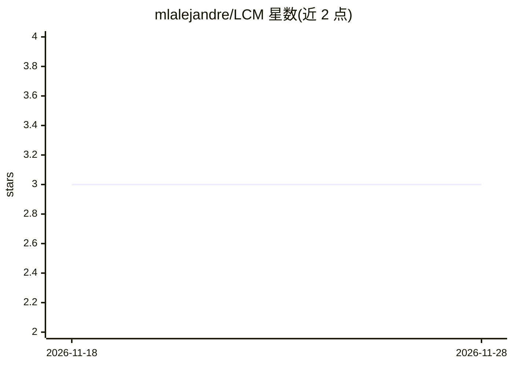

# mlalejandre/LCM

⭐ 3 · Python · MIT · 推送 2026-11-21 · [GitHub](https://github.com/mlalejandre/LCM) · 个人维护

**西班牙语研究实验：无 LLM 的对话学习概念推理系统**

研究性质的原型系统：通过西班牙语对话学习语言，不依赖任何 LLM。以概念向量表示语义，用可读规则做推理（含 transformer 选择推理槽位），每条回答附可读的解释，并带睡眠巩固机制。包含 UD 依赖分析器、概念空间、记忆（事实+来源+反例）、动作效果与一致性模块。作者自述为研究实验，评测集由作者自拟、分数偏乐观；回复用模板生成而非自由文本生成；仅面向西班牙语，其他语言仅是假设。

## 筛选速览

| 维度 | 判定 | 备注 |
|---|---|---|
| AI 角色 | `ai-native` | 本体是模型或模型工具 |
| 许可风险 | `permissive` | MIT |
| 部署形态 | `library` | 以包/库形式分发 |
| 模型依赖 | — | README 未给出锁定关系 |
| 硬件要求 | — | 无带数字的原话,不猜 |
| 安装摩擦 | `medium` | 含编译或系统依赖之一 |
| 成熟度 | `idea` | |

## 能力要点

- 概念向量 + 角色矩阵的神经符号推理，附可读规则
- 对话中在线学习，睡眠周期巩固重要事实、丢弃噪声
- 一条命令 python -m scripts.reproduce 从零复现全流程
- Web 界面含概念图谱浏览器，仅本地运行

## 适用场景

- 体验一个不用 LLM 的西班牙语对话学习系统
- 研究神经符号 NLU 与持续学习的可复现实现
- 复现并检视作者公开的评测与限制

## 场景标签

 · 领域:AI 研究/自然语言处理

## 证据(README 行号)

> L7: **Una IA que aprende español conversando, sin ningún LLM.**
> L48: - **Razonador** (`src/model/reasoner.py`): un *lector* separa cada premisa en tres ranuras restando el predicado, e

## 星数曲线

2026-11-18 3 → 2026-11-28 3（+0）

---
*卡片 v1 · prompt 1.4 · 生成 2026-11-21 · 置信度 mid · 依据 README sha `4809b21f9c50` · [字段定义](../../DATASET.md)*
