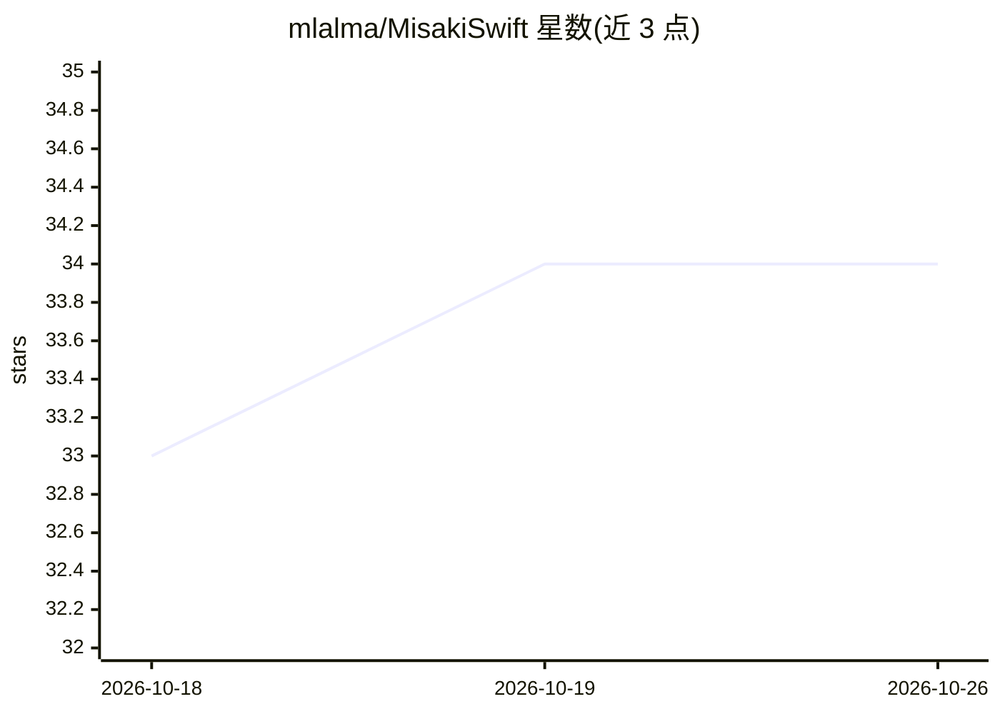

# mlalma/MisakiSwift

⭐ 34 · Swift · Apache-2.0 · 推送 2026-06-30 · [GitHub](https://github.com/mlalma/MisakiSwift) · 个人维护

**Apple 平台的英语 G2P 库，为 Kokoro TTS 生成音素**

Misaki G2P 的 Swift 移植库，将英文文本转换为音素表示，供 Kokoro 等文本转语音引擎使用。机制上采用词典查询（gold/silver 双词典）与神经网络回退（BART 模型移植到 MLX 运行）结合的管线，支持英式/美式发音、Markdown 式自定义音素覆盖与重音控制；使用 Apple NaturalLanguage 框架替代 Python 版的 SpaCy。以 Swift Package Manager 包分发，模型权重与词典随包内置。支持 iOS 18.0+ 与 macOS 15.0+。

## 筛选速览

| 维度 | 判定 | 备注 |
|---|---|---|
| AI 角色 | `ai-native` | 本体是模型或模型工具 |
| 许可风险 | `permissive` | Apache-2.0 |
| 部署形态 | `None` |  |
| 模型依赖 | — | README 未给出锁定关系 |
| 硬件要求 | — | 无带数字的原话,不猜 |
| 安装摩擦 | `low` | 无编译、无系统依赖或容器化 |
| 成熟度 | — | 结构信号不足 |

## 能力要点

- 词典查询 + BART 回退网络（MLX 移植）的 G2P 管线
- 支持英式与美式英语两种发音变体
- Markdown 式语法指定自定义音素发音
- 模型权重与词典作为包资源自动捆绑、运行时加载

## 适用场景

- 在 iOS/macOS 应用中为 Kokoro TTS 前置生成音素
- 需要英式或美式英语发音转换的语音应用
- 为专有名词固定发音的自定义场景

## 场景标签

 · 领域:语音处理/文本转语音

## 证据(README 行号)

> L3: A Swift port of the Misaki grapheme-to-phoneme (G2P) library for converting English text to phonetic representations
> L58: - **`EnglishG2P`**: Main conversion pipeline that orchestrates tokenization, lexicon lookup, and neural network fal
> L65: 2. **Neural Network**: The BART-based fallback network is ported to run on MLX

## 星数曲线

2026-10-18 33 → 2026-10-26 34（+1）

---
*卡片 v1 · prompt 1.4 · 生成 2026-10-25 · 置信度 high · 依据 README sha `04fcea91d342` · [字段定义](../../DATASET.md)*
