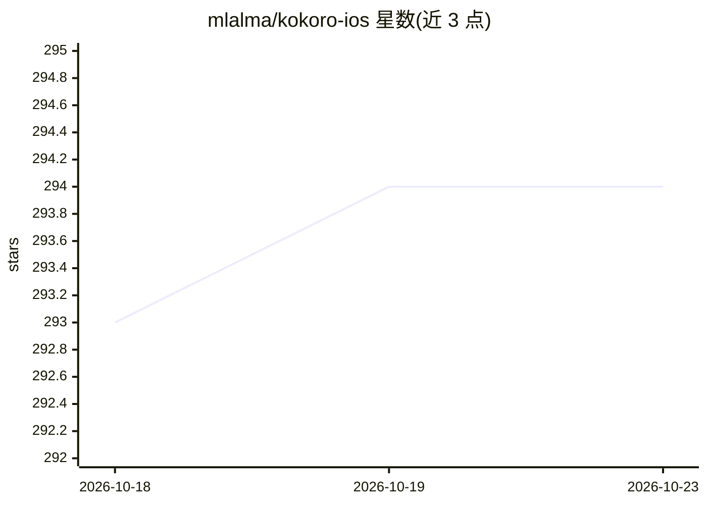

# mlalma/kokoro-ios

⭐ 294 · Swift · MIT · 推送 2026-01-10 · [GitHub](https://github.com/mlalma/kokoro-ios) · 个人维护

**Kokoro TTS 的 Swift/MLX 移植库，供 iOS/macOS 应用集成语音合成**

将 Kokoro 文本转语音模型从 MLX Python 移植到 MLX Swift 的 SPM 库，面向 Apple 平台开发者。读取文本与模型文件，在设备上生成英文语音，README 称在 iPhone 13 Pro release 构建上约为实时速度 3.3 倍；1.0.8 起提供逐 token 时间戳。G2P 默认使用 MisakiSwift，eSpeakNG 备选但当前版本被注释掉。因模型体积大，模型文件与声音风格需由集成方自行提供，参考示例工程为 KokoroTestApp。依赖 MLX Swift、MisakiSwift 与 MLXUtilsLibrary。

## 筛选速览

| 维度 | 判定 | 备注 |
|---|---|---|
| AI 角色 | `ai-native` | 本体是模型或模型工具 |
| 许可风险 | `permissive` | MIT |
| 部署形态 | `None` |  |
| 模型依赖 | — | README 未给出锁定关系 |
| 硬件要求 | — | 无带数字的原话,不猜 |
| 安装摩擦 | `low` | 无编译、无系统依赖或容器化 |
| 成熟度 | — | 结构信号不足 |

## 能力要点

- Kokoro TTS 从 PyTorch→MLX Python→MLX Swift 的移植链路
- iPhone 13 Pro release 构建上约 3.3 倍实时速度生成音频
- 逐 token 时间戳（1.0.8 新增）
- SPM 包形式提供，模型文件由集成方提供

## 适用场景

- 在 iOS/macOS 应用中离线集成英文 TTS
- 为语音内容生成逐 token 时间戳
- 利用 Apple Silicon 通过 MLX 跑 TTS 推理

## 场景标签

`语音合成` · 领域:内容生成

## 证据(README 行号)

> L7: Kokoro is a high-quality TTS (text-to-speech) model, providing faster than real-time English audio generation.
> L11: Kokoro TTS port is based on the great work done in MLX-Audio project, where the model was ported from PyTorch to ML
> L13: Currently the library generates audio ~3.3 times faster than real-time on the release build on iPhone 13 Pro after 

## 星数曲线

2026-10-18 293 → 2026-10-23 294（+1）

---
*卡片 v1 · prompt 1.4 · 生成 2026-10-21 · 置信度 high · 依据 README sha `31c5654439ec` · [字段定义](../../DATASET.md)*
