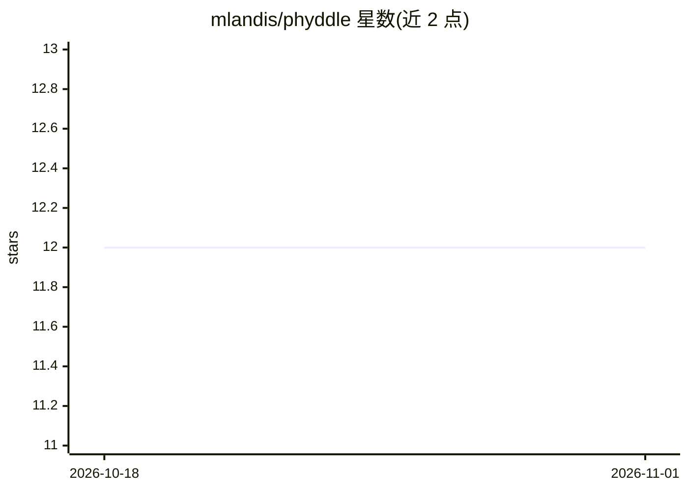

# mlandis/phyddle

⭐ 12 · Python · NOASSERTION · 推送 2026-06-15 · [GitHub](https://github.com/mlandis/phyddle) · [官网](https://phyddle.org) · 组织维护

**用深度学习探索系统发育模型的科研流水线工具**

phyddle 是一套用深度学习做系统发育（phylogenetic）模型推断的流水线软件：通过用户设计的模拟器生成大规模训练数据，编码为张量后训练神经网络，再用训练好的网络对新的系统发育数据集估计模型参数，并生成汇总图表。面向系统发育建模研究者与方法开发者，特别适用于似然函数不可解析的模型。流水线通过配置文件与命令行驱动，依赖 R、RevBayes、BEAST 等第三方模拟器生成训练数据，由华盛顿大学团队随 Systematic Biology 论文发布。

## 筛选速览

| 维度 | 判定 | 备注 |
|---|---|---|
| AI 角色 | `ai-native` | 本体是模型或模型工具 |
| 许可风险 | `none` | NOASSERTION |
| 部署形态 | `library` | 以包/库形式分发 |
| 模型依赖 | — | README 未给出锁定关系 |
| 硬件要求 | — | 无带数字的原话,不猜 |
| 安装摩擦 | `low` | 无编译、无系统依赖或容器化 |
| 成熟度 | — | 结构信号不足 |

## 能力要点

- Simulate→Format→Train→Estimate→Plot 五阶段流水线，配置文件与命令行驱动
- 用模拟数据训练神经网络替代不可解析的似然函数进行参数估计
- 支持 R、RevBayes、Phylojunction、BEAST+MASTER 等第三方模拟器生成训练集
- 训练集规模建议 1 万至 100 万条模拟示例

## 适用场景

- 对似然不可解析的系统发育模型做参数估计
- 研究深度学习方法在标准系统发育估计任务中的表现
- 构建可复用的系统发育模拟-训练-推断工作流

## 场景标签

`科研工具` · 领域:学习与行业

## 证据(README 行号)

> L16: - **Estimate** estimates model parameters for a new dataset with the trained network (from *Train*).
> L82: Thanks for your interest in phyddle. The phyddle project emerged from a phylogenetic deep learning study led by Amm

## 星数曲线

2026-10-18 12 → 2026-11-01 12（+0）

---
*卡片 v1 · prompt 1.4 · 生成 2026-11-01 · 置信度 high · 依据 README sha `529e055ad926` · [字段定义](../../DATASET.md)*
