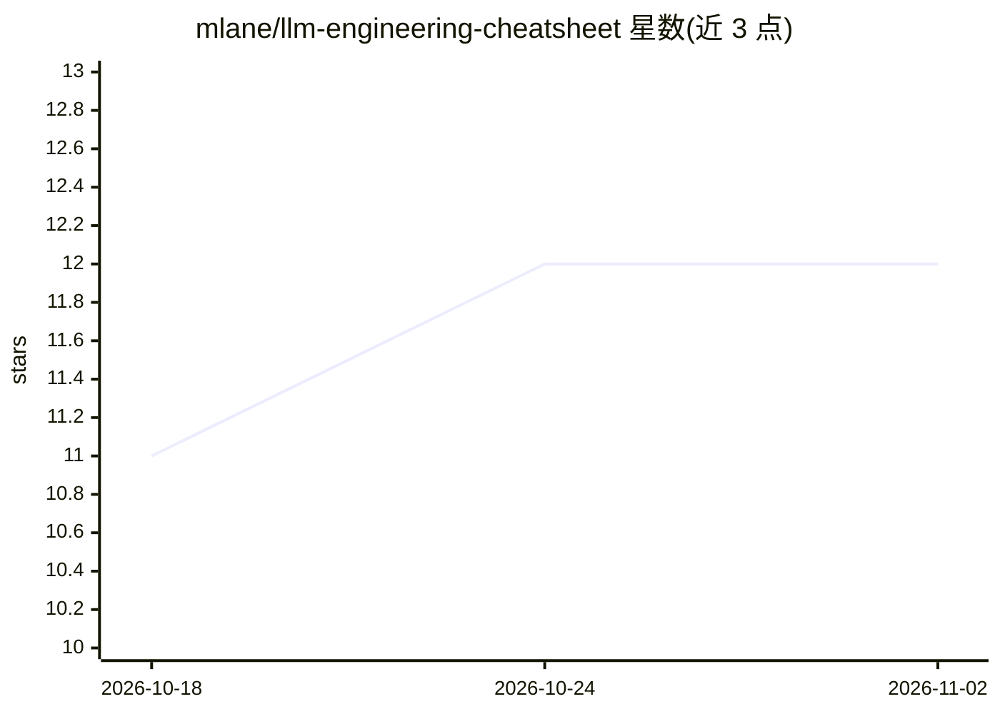

# mlane/llm-engineering-cheatsheet

⭐ 12 · MIT · 推送 2026-05-10 · [GitHub](https://github.com/mlane/llm-engineering-cheatsheet) · 个人维护

**跨模型通用的 LLM 工程原则与提示模式速查指南**

一份面向提示工程的思维与原则参考手册：不绑定特定模型或工具，覆盖零样本/少样本提示、角色提示、约束输出、采样参数、提示结构五要素、上下文管理、评估原则、常见失败模式与调试清单。内容引用 Andrew Ng 的实践建议，附带 OpenAI API 的最小 Python 示例及推荐资源（OpenAI 最佳实践、LangChain 文档、Ollama）。以 Markdown 文档形式提供，无需安装运行。

## 筛选速览

| 维度 | 判定 | 备注 |
|---|---|---|
| AI 角色 | `ai-knowledge` | 知识聚合/清单类 |
| 许可风险 | `permissive` | MIT |
| 部署形态 | `None` |  |
| 模型依赖 | — | README 未给出锁定关系 |
| 硬件要求 | — | 无带数字的原话,不猜 |
| 安装摩擦 | `low` | 无编译、无系统依赖或容器化 |
| 成熟度 | — | 结构信号不足 |

## 能力要点

- 跨模型/供应商通用的提示工程原则与模式
- 提示结构五要素（角色/任务/输入/约束/示例）
- 常见失败模式对照表与输出调试清单
- 引用 Andrew Ng 一秒规则等实践建议

## 适用场景

- 学习提示工程的核心原则与通用模式
- LLM 输出不符合预期时按调试清单排查
- 作为团队内部的提示工程参考资料

## 场景标签

`提示工程` `教程课程` · 领域:Agent 开发

## 证据(README 行号)

> L3: A timeless guide to **thinking and building like a prompt engineer**. This cheatsheet focuses on core principles and
> L5: > This is not a cookbook or quickstart. It's a mindset guide - built for those who want to reason clearly and build 

## 星数曲线

2026-10-18 11 → 2026-11-02 12（+1）

---
*卡片 v1 · prompt 1.4 · 生成 2026-11-01 · 置信度 high · 依据 README sha `9fbaddccb210` · [字段定义](../../DATASET.md)*
