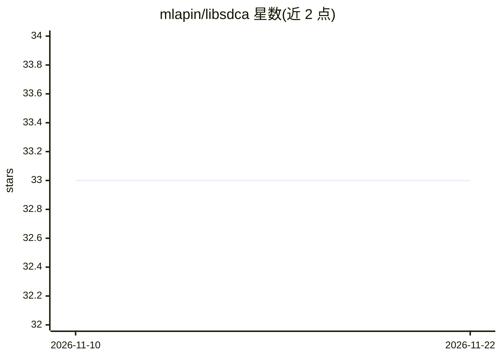

# mlapin/libsdca

⭐ 33 · Python · MIT · 推送 2026-11-17 · [GitHub](https://github.com/mlapin/libsdca) · [官网](https://mlapin.github.io/libsdca/) · 个人维护

**多语言分类损失函数库：交叉熵、top-k、SVM、蒸馏损失与 SDCA 求解器**

提供融合 CPU/CUDA 内核的分类损失实现：交叉熵、多类/多标签 SVM hinge、top-k 损失与知识蒸馏损失，并通过随机对偶坐标上升（SDCA）求解器训练线性与核分类器，附带对偶间隙收敛保证。接口覆盖 PyTorch、JAX、NumPy、scikit-learn、Rust、C++、C 与 MATLAB，各接口统一损失与选项命名。数值上通过高精度参考测试保持梯度的数值稳定性。Linux x86_64 与 macOS arm64 提供预编译 wheel，其他平台从源码构建；CUDA 仅支持 Linux NVIDIA GPU。

## 筛选速览

| 维度 | 判定 | 备注 |
|---|---|---|
| AI 角色 | `ai-native` | 本体是模型或模型工具 |
| 许可风险 | `permissive` | MIT |
| 部署形态 | `library` | 以包/库形式分发 |
| 模型依赖 | — | README 未给出锁定关系 |
| 硬件要求 | — | 无带数字的原话,不猜 |
| 安装摩擦 | `high` | 编译与系统依赖俱全 |
| 成熟度 | — | 结构信号不足 |

## 能力要点

- 融合 CPU/CUDA 内核的分类损失族（交叉熵、hinge、top-k、蒸馏）
- SDCA 求解器训练线性与核分类器，含对偶间隙收敛保证
- 8 种接口（PyTorch/JAX/NumPy/sklearn/Rust/C++/C/MATLAB）统一命名
- linear_cross_entropy 支持语言模型头免生成 (N, V) logits

## 适用场景

- 在 PyTorch/JAX 训练中替换数值不稳定的损失实现
- 用 SDCA 求解器训练多类/top-k/多标签 SVM 分类器
- 大规模类别（数万至十万级）场景下的语言模型交叉熵计算
- 在 Rust/C++/MATLAB 项目中复用同一套损失实现

## 场景标签

`模型训练` `微调` · 领域:训练与推理

## 证据(README 行号)

> L9: **libsdca** is a fast and accurate implementation of classification losses: cross-entropy,
> L12: functions, and a stochastic dual coordinate ascent (SDCA) solver trains linear and kernel
> L35: - **SDCA solver with a duality-gap guarantee:** SDCA trains linear and kernel classifiers

## 星数曲线

2026-11-10 33 → 2026-11-22 33（+0）

---
*卡片 v1 · prompt 1.4 · 生成 2026-11-18 · 置信度 high · 依据 README sha `245f3ae53c5c` · [字段定义](../../DATASET.md)*
