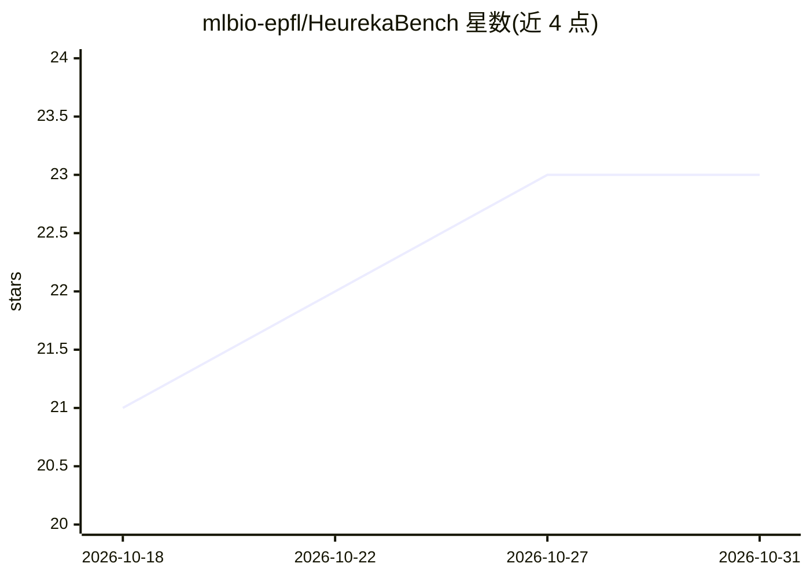

# mlbio-epfl/HeurekaBench

⭐ 23 · Python · MIT · 推送 2026-10-30 · [GitHub](https://github.com/mlbio-epfl/HeurekaBench) · [官网](https://brbiclab.epfl.ch/projects/heurekabench/) · 组织维护

**面向实验科学数据的 AI 共同科学家基准构建与评测框架**

ICLR 2026 论文配套框架，用于在实验数据集上创建开放式科学探索基准并评测 AI 共同科学家（agent）。每道题锚定一篇科学论文及其代码仓库，通过多 LLM 半自动流水线三阶段生成（洞见抽取→问题生成→自主解题），答案与已发表结论比对。提供单细胞领域实例 sc-HeurekaBench，支持运行开源/闭源 LLM 基线及 CellVoyager、Biomni 等 agent，含数据下载、运行与指标计算脚本，可扩展到其他科学领域。

## 筛选速览

| 维度 | 判定 | 备注 |
|---|---|---|
| AI 角色 | `ai-ecosystem` | LLM/agent 周边工具 |
| 许可风险 | `permissive` | MIT |
| 部署形态 | `library` | 以包/库形式分发 |
| 模型依赖 | local-ok | 支持本地模型 |
| 硬件要求 | — | 无带数字的原话,不猜 |
| 安装摩擦 | `low` | 无编译、无系统依赖或容器化 |
| 成熟度 | — | 结构信号不足 |

## 能力要点

- 三阶段流水线：洞见抽取→问题生成→agent 自主多步分析求解
- 每题锚定真实科学论文与代码仓库，答案对照已发表结论评估
- 内置单细胞领域实例 sc-HeurekaBench（mcq/oeq 题库与数据集）
- 提供开源 LLM（vLLM 服务）与闭源 LLM（Claude/GPT）基线运行脚本

## 适用场景

- 在单细胞数据基准上评测我的 AI agent 的科学研究能力
- 为自己的实验科学领域构建新的 AI 共同科学家基准
- 对比开源与闭源 LLM 作为科学 agent 的表现

## 场景标签

`模型评测` `科研工具` · 领域:评测与运维

## 证据(README 行号)

> L10: **HeurekaBench** is a framework to create benchmarks with exploratory, open-ended research questions on experimenta
> L25: In the question solving stage, an AI agent is provided with the questions from the benchmark and has to autonomousl
> L145: # :bulb: HeurekaBench for creating new scientific benchmarks

## 星数曲线

2026-10-18 21 → 2026-10-31 23（+2）

---
*卡片 v1 · prompt 1.4 · 生成 2026-10-27 · 置信度 high · 依据 README sha `8723dfd8759e` · [字段定义](../../DATASET.md)*
