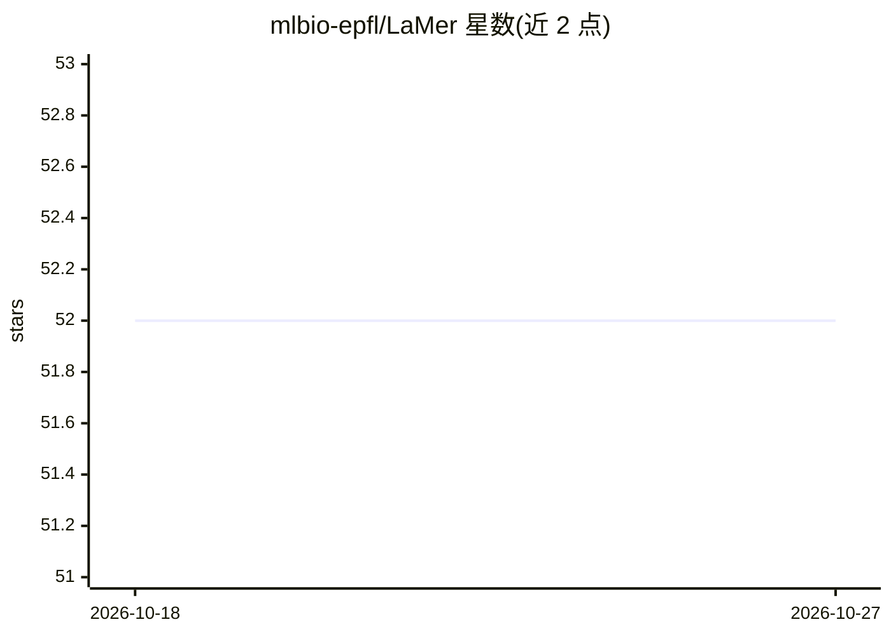

# mlbio-epfl/LaMer

⭐ 52 · Python · 推送 2026-02-01 · [GitHub](https://github.com/mlbio-epfl/LaMer) · [官网](https://brbiclab.epfl.ch/projects/LaMer/) · 组织维护

**训练 LLM agent 测试时主动探索与适应的 Meta-RL 框架**

ICLR 2026 论文的官方源码仓库，提供 LaMer：一种训练 LLM agent 在测试阶段主动探索环境并适应的 Meta-RL 框架。README 给出通过 bash 脚本以 Minesweeper 环境和 Qwen3-4B 训练的示例命令，并同时提供 RL 基线（如 GIGPO）的训练脚本；更多示例位于 examples 目录，agent 环境的安装测试按单独说明进行。代码构建于 verl、verl-agent、reflexion、RAGEN 等项目之上，README 未给出 pip 等安装命令与结果数字。

## 筛选速览

| 维度 | 判定 | 备注 |
|---|---|---|
| AI 角色 | `ai-ecosystem` | LLM/agent 周边工具 |
| 许可风险 | `none` | — |
| 部署形态 | `None` |  |
| 模型依赖 | — | README 未给出锁定关系 |
| 硬件要求 | — | 无带数字的原话,不猜 |
| 安装摩擦 | `low` | 无编译、无系统依赖或容器化 |
| 成熟度 | — | 结构信号不足 |

## 能力要点

- Meta-RL 训练 LLM agent 测试时探索与适应环境
- 提供 Minesweeper + Qwen3-4B 训练脚本示例
- 附带 RL 基线训练脚本（如 GIGPO）
- 构建于 verl / verl-agent / reflexion / RAGEN 之上

## 适用场景

- 复现论文中 LLM agent 的探索与适应实验
- 在自定义环境中训练具备测试时探索能力的 LLM agent
- 对比 LaMer 与 RL 基线的训练效果

## 场景标签

`强化学习` · 领域:训练与推理

## 证据(README 行号)

> L7: This repo contains the source code of 🌊LaMer, a Meta-RL framework of training LLM agents to actively explore and ada
> L24: This work is built upon verl, verl-agent, reflexion, RAGEN. We thank the authors and contributors of these projects

## 星数曲线

2026-10-18 52 → 2026-10-27 52（+0）

---
*卡片 v1 · prompt 1.4 · 生成 2026-10-24 · 置信度 mid · 依据 README sha `3fe1646a3bfe` · [字段定义](../../DATASET.md)*
