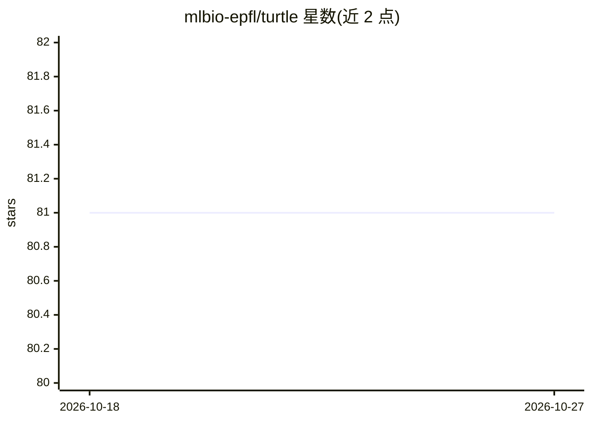

# mlbio-epfl/turtle

⭐ 81 · Python · 推送 2025-12-03 · [GitHub](https://github.com/mlbio-epfl/turtle) · [官网](https://brbiclab.epfl.ch/projects/turtle/) · 组织维护

**利用基础模型表征做无监督迁移聚类的 PyTorch 研究代码**

ICML 2024 论文 Let Go of Your Labels with Unsupervised Transfer 的官方源码：TURTLE 在仅给定类别数的前提下，通过最大化线性分类器间隔的双层优化，从基础模型表征空间中搜索下游数据集的潜在人工标注，实现完全无监督迁移。支持 26 个视觉数据集与 9 种表征（CLIP 系列、DINOv2），提供预计算脚本、训练与评估流程，并附带 Linear Probe、K-Means、CLIP zero-shot 基线及预训练标注检查点下载。依赖 cuml 的 CUDA 实现。

## 筛选速览

| 维度 | 判定 | 备注 |
|---|---|---|
| AI 角色 | `ai-native` | 本体是模型或模型工具 |
| 许可风险 | `none` | — |
| 部署形态 | `None` |  |
| 模型依赖 | — | README 未给出锁定关系 |
| 硬件要求 | — | 无带数字的原话,不猜 |
| 安装摩擦 | `medium` | 含编译或系统依赖之一 |
| 成熟度 | — | 结构信号不足 |

## 能力要点

- 在基础模型表征空间搜索最大化分类器间隔的标注（无需任何监督）
- 支持 26 个数据集与 9 种表征，可组合单一或多个表征空间
- 附带 Linear Probe / K-Means / CLIP zero-shot 基线实现
- 提供全部数据集与架构的预训练标注检查点下载与评估脚本

## 适用场景

- 在仅有类别数信息时对下游数据集做无监督聚类迁移
- 复现论文中跨 26 个视觉数据集的实验结果
- 对比无监督迁移与 zero-shot、线性探针等迁移方式

## 场景标签

 · 领域:机器学习研究/无监督迁移

## 证据(README 行号)

> L6: This repo contains the source code of 🐢 TURTLE, an unupervised learning algorithm written in PyTorch. 🔥 TURTLE achie
> L10:  TURTLE is a method that enables fully unsupervised transfer from foundation models. The key idea behind our approa
> L65: - 26 datasets: ```food101, cifar10, cifar100, birdsnap, sun397, cars, aircraft, dtd, pets, caltech101, flowers, mni

## 星数曲线



2026-10-18 81 → 2026-10-27 81（+0）


---
*卡片 v1 · prompt 1.4 · 生成 2026-10-24 · 置信度 high · 依据 README sha `6e0a75ad5e8e` · [字段定义](../../DATASET.md)*
