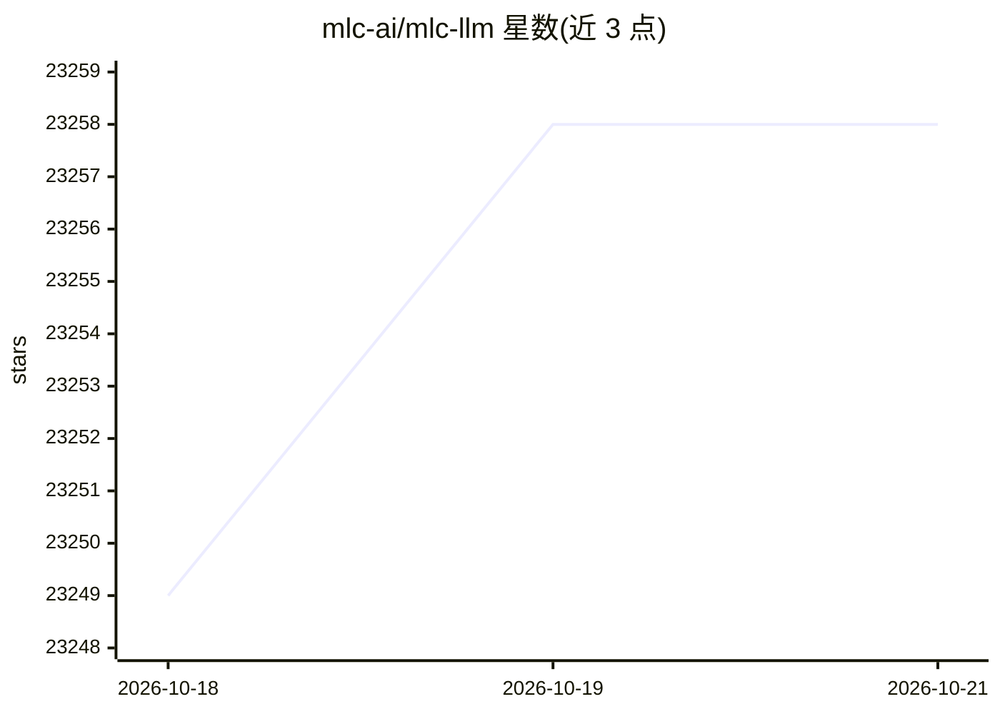

# mlc-ai/mlc-llm

⭐ 23,258 · Python · Apache-2.0 · 推送 2026-10-06 · [GitHub](https://github.com/mlc-ai/mlc-llm) · [官网](https://llm.mlc.ai/) · 组织维护

**面向多平台本地部署 LLM 的编译与推理引擎**

MLC LLM 是面向大语言模型的机器学习编译器与部署引擎，通过 ML Compilation 将模型编译后在统一推理引擎 MLCEngine 上运行，覆盖 Linux/Windows（Vulkan、ROCm、CUDA）、macOS（Metal）、Web 浏览器（WebGPU/WASM）、iOS/iPadOS 与 Android（OpenCL on Adreno/Mali）等平台。MLCEngine 提供 OpenAI 兼容 API，可通过 REST server、Python、JavaScript、iOS、Android 调用。安装与上手方式指向官方文档，项目以软件引用（bibtex）形式给出引文信息，并列出其底层技术（如 TensorIR）的学术论文。

## 筛选速览

| 维度 | 判定 | 备注 |
|---|---|---|
| AI 角色 | `ai-native` | 本体是模型或模型工具 |
| 许可风险 | `permissive` | Apache-2.0 |
| 部署形态 | `None` |  |
| 模型依赖 | — | README 未给出锁定关系 |
| 硬件要求 | — | 无带数字的原话,不猜 |
| 安装摩擦 | `medium` | 含编译或系统依赖之一 |
| 成熟度 | — | 结构信号不足 |

## 动量与使用信号

- 维护:`active` — 距上次 push 11.4 天,年发版 0,159 位贡献者
- 涨星:近 1 天 **-1**(自 20261016 起算)
- 平台:MACOS / LINUX / ANDROID / IOS · 协议:OPENAI-API

## 能力要点

- 统一推理引擎 MLCEngine 跨桌面、移动与浏览器平台运行
- 提供 OpenAI 兼容 API，支持 REST server、Python、JavaScript、iOS、Android 接入
- 支持 NVIDIA/AMD/Apple/Intel GPU 与 Metal、Vulkan、CUDA、ROCm、WebGPU、OpenCL 等后端
- 以机器学习编译（ML Compilation）为核心技术路线

## 适用场景

- 在本地 GPU 或移动设备上部署大语言模型
- 在浏览器中通过 WebGPU/WASM 运行 LLM
- 为 iOS/Android 应用集成本地 LLM 推理能力
- 通过 REST server 提供 OpenAI 兼容接口

## 场景标签

`推理引擎` · 领域:训练与推理

## 证据(README 行号)

> L14: MLC LLM is a machine learning compiler and high-performance deployment engine for large language models. The missio
> L43: MLC LLM compiles and runs code on MLCEngine -- a unified high-performance LLM inference engine across the above pla

## 星数曲线

2026-10-18 23,249 → 2026-10-21 23,258（+9）

---
*卡片 v1 · prompt 1.4 · 生成 2026-10-18 · 置信度 high · 依据 README sha `1d55b057e8fa` · [字段定义](../../DATASET.md)*
