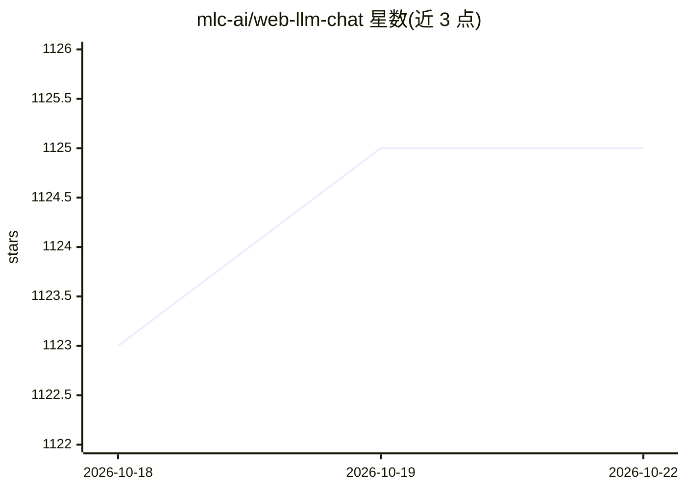

# mlc-ai/web-llm-chat

⭐ 1,126 · TypeScript · Apache-2.0 · 推送 2026-02-18 · [GitHub](https://github.com/mlc-ai/web-llm-chat) · [官网](https://chat.webllm.ai/) · 组织维护

**浏览器内本地运行 LLM 的隐私聊天界面**

基于 WebLLM 与 NextChat 界面的网页聊天应用：利用 WebGPU 在浏览器本地运行大语言模型，无需服务器端处理或云依赖；模型与数据处理均在本地，初次下载后可离线使用。支持上传图片的视觉模型对话、markdown/暗色模式界面，并可通过 MLC-LLM REST API 接入自定义本地模型。以 Next.js 构建，提供 GitHub Pages 部署与 Docker 构建方式，属于 MLC.ai 项目家族。

## 筛选速览

| 维度 | 判定 | 备注 |
|---|---|---|
| AI 角色 | `ai-native` | 本体是模型或模型工具 |
| 许可风险 | `permissive` | Apache-2.0 |
| 部署形态 | `self-host` | docker 或自建部署 |
| 模型依赖 | — | README 未给出锁定关系 |
| 硬件要求 | — | 无带数字的原话,不猜 |
| 安装摩擦 | `low` | 无编译、无系统依赖或容器化 |
| 成熟度 | — | 结构信号不足 |

## 能力要点

- WebGPU 加速在浏览器内本地运行 LLM，数据不出本机
- 初次下载后可完全离线使用
- 支持视觉模型对话（上传图片）
- 通过 MLC-LLM REST API 接入自定义本地模型

## 适用场景

- 在没有服务器或云服务的情况下与 LLM 对话
- 本地私密对话，数据不离开设备
- 离线环境下继续使用 AI 聊天
- 接入自己编译的 MLC 格式自定义模型

## 场景标签

`聊天机器人` · 领域:对话与助手

## 证据(README 行号)

> L15: **WebLLM Chat** is a private AI chat interface that combines WebLLM with a user-friendly design, leveraging WebGPU 
> L19: - **Browser-Native AI**: Experience cutting-edge language models running natively within your web browser with WebG

## 星数曲线

2026-10-18 1,123 → 2026-10-22 1,125（+2）

---
*卡片 v1 · prompt 1.4 · 生成 2026-10-21 · 置信度 high · 依据 README sha `a942a1111c66` · [字段定义](../../DATASET.md)*
