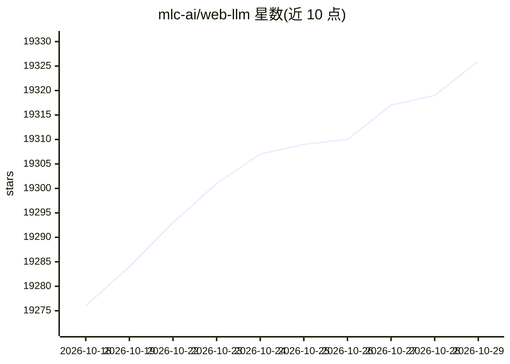

# mlc-ai/web-llm

⭐ 19,326 · TypeScript · Apache-2.0 · 推送 2026-10-11 · [GitHub](https://github.com/mlc-ai/web-llm) · [官网](https://webllm.mlc.ai) · 组织维护

**开发者用浏览器内 LLM 推理引擎：WebGPU 加速、无需服务器**

运行在浏览器中的 LLM 推理引擎，依赖 WebGPU 做硬件加速，推理全部在客户端完成、无服务器参与。以 npm 包形式提供 MLCEngine 接口，兼容 OpenAI API 风格（流式、JSON-mode、seed、function-calling 为初步支持），支持 Web Worker 与 Service Worker 将计算移出主线程，提供 Chrome 扩展示例。模型以 MLC 格式接入，首次加载需下载模型文件。是 MLC LLM 的伴生项目。

## 筛选速览

| 维度 | 判定 | 备注 |
|---|---|---|
| AI 角色 | `ai-ecosystem` | LLM/agent 周边工具 |
| 许可风险 | `permissive` | Apache-2.0 |
| 部署形态 | `library` | 以包/库形式分发 |
| 模型依赖 | — | README 未给出锁定关系 |
| 硬件要求 | — | 无带数字的原话,不猜 |
| 安装摩擦 | `low` | 无编译、无系统依赖或容器化 |
| 成熟度 | — | 结构信号不足 |

## 动量与使用信号

- 维护:`active` — 距上次 push 6.8 天,年发版 5,55 位贡献者
- 涨星:近 1 天 **+4**(自 20261016 起算)
- 安装:npm 包 `@mlc-ai/web-llm` 月下载 467,555
- 平台:— · 协议:OPENAI-API

## 能力要点

- 浏览器内推理，WebGPU 硬件加速，无服务器支持
- 全量兼容 OpenAI API：流式、JSON-mode、seed、function-calling（WIP）
- 支持 Web Worker / Service Worker 卸载计算与离线缓存
- 四种缓存后端（Cache API、IndexedDB、OPFS、cross-origin 扩展）

## 适用场景

- 在 Web 应用中本地运行 LLM 聊天补全而不搭建后端
- 利用 Service Worker 实现模型缓存的离线推理页面
- 开发内置 LLM 的 Chrome 扩展
- 隐私敏感场景下的客户端推理

## 场景标签

`推理引擎` · 领域:训练与推理

## 证据(README 行号)

> L15: WebLLM is a high-performance in-browser LLM inference engine that brings language model inference directly onto web
> L18: WebLLM is **fully compatible with OpenAI API.**
> L24: You can use WebLLM as a base npm package and build your own web application on top of it by following the examples 

## 星数曲线

2026-10-18 19,276 → 2026-10-29 19,326（+50）

---
*卡片 v1 · prompt 1.4 · 生成 2026-10-18 · 置信度 high · 依据 README sha `03facd47074b` · [字段定义](../../DATASET.md)*
