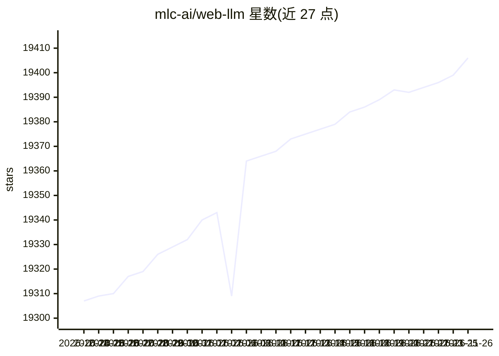

# mlc-ai/web-llm

⭐ 19,406 · TypeScript · Apache-2.0 · 推送 2026-11-20 · [GitHub](https://github.com/mlc-ai/web-llm) · [官网](https://webllm.mlc.ai) · 组织维护

**给 Web 开发者的浏览器内 LLM 推理引擎，无需服务器**

一个运行在浏览器内、基于 WebGPU 硬件加速的 LLM 推理引擎，全部计算在客户端完成、不依赖服务器。以 npm 包形式提供，接口与 OpenAI API 兼容，支持流式输出、JSON 模式、种子复现与初步的 function calling；内置 Llama、Phi、Gemma、Mistral、Qwen 等模型家族，也可接入 MLC 格式的自定义模型。提供 Web Worker、Service Worker 与 Chrome 扩展集成示例，模型权重首次运行需下载并支持四种浏览器缓存后端。面向希望在网页应用中接入本地 LLM 能力的开发者。

## 筛选速览

| 维度 | 判定 | 备注 |
|---|---|---|
| AI 角色 | `ai-ecosystem` | LLM/agent 周边工具 |
| 许可风险 | `permissive` | Apache-2.0 |
| 部署形态 | `library` | 以包/库形式分发 |
| 模型依赖 | — | README 未给出锁定关系 |
| 硬件要求 | — | 无带数字的原话,不猜 |
| 安装摩擦 | `low` | 无编译、无系统依赖或容器化 |
| 成熟度 | — | 结构信号不足 |

## 动量与使用信号

- 维护:`active` — 距上次 push 6.8 天,年发版 5,55 位贡献者
- 涨星:近 1 天 **+4**(自 20261016 起算)
- 安装:npm 包 `@mlc-ai/web-llm` 月下载 467,555
- 平台:— · 协议:OPENAI-API

## 能力要点

- 浏览器内推理，WebGPU 加速，无服务器依赖
- 完整 OpenAI API 兼容（流式/JSON 模式/seed/function calling）
- 内置 Llama、Phi、Gemma、Mistral、Qwen 等模型家族，支持 MLC 格式自定义模型
- 支持 Web Worker、Service Worker 与 Chrome 扩展集成

## 适用场景

- 在网页应用中直接嵌入本地 LLM 对话能力
- 构建注重隐私的浏览器端 AI 助手
- 开发带后台持久推理的 Chrome 扩展

## 场景标签

`推理引擎` · 领域:训练与推理

## 证据(README 行号)

> L15: WebLLM is a high-performance in-browser LLM inference engine that brings language model inference directly onto web
> L18: WebLLM is **fully compatible with OpenAI API.**
> L24: You can use WebLLM as a base npm package and build your own web application on top of it by following the examples 

## 星数曲线

2026-10-24 19,307 → 2026-11-26 19,406（+99）

---
*卡片 v1 · prompt 1.4 · 生成 2026-11-22 · 置信度 high · 依据 README sha `3e598e15fd8d` · [字段定义](../../DATASET.md)*
